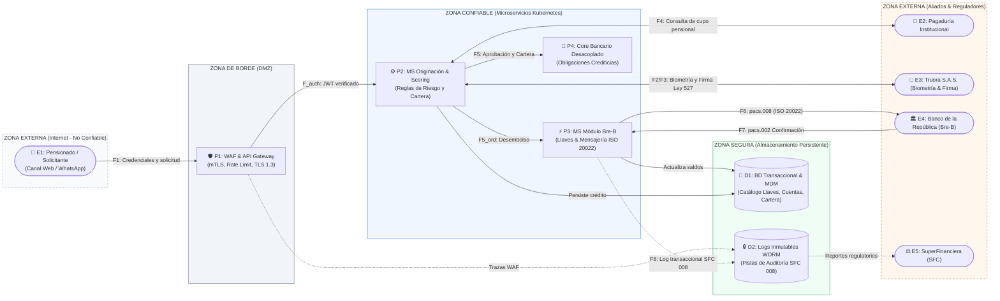
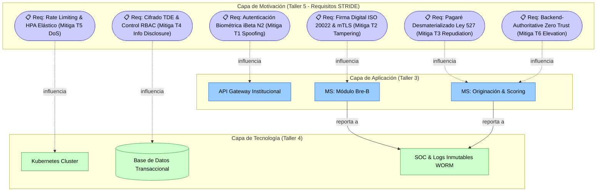

# 📄 Informe Técnico del Taller 5: Evaluación de Seguridad con STRIDE

**Taller 5 — Evaluación de Seguridad con STRIDE: Caso Ban100**  
*Dominio de Seguridad del MAE (MRAE v3.0 MinTIC): Modelado de Amenazas, Límites de Confianza, Circular Externa 008/2023 SFC y Ecosistema Bre-B*

- **Santiago Barrera Rueda**
- **Krish Purmessur Moros**
- **Samuel Guerrero Arcos**

**Fecha:** 5 de Septiembre de 2026  
**Curso:** Arquitectura Empresarial (AREM) — Universidad de La Sabana  
**Entregable del Diagrama DFD:** [`dfd-seguridad-stride-ban100.drawio`](dfd-seguridad-stride-ban100.drawio)  
**Matriz Completa STRIDE (Excel):** [`tabla-stride-cliente.xlsx`](tabla-stride-cliente.xlsx)

---

## 1. Descripción General del Trabajo

El objetivo primordial de este taller consistió en realizar una **evaluación formal de amenazas de seguridad sobre un flujo crítico de Ban100** aplicando el marco metodológico **STRIDE** (*Spoofing, Tampering, Repudiation, Information Disclosure, Denial of Service, Elevation of Privilege*), articulado con los requerimientos normativos obligatorios de la **Circular Externa 008 de 2023 de la Superintendencia Financiera de Colombia (SFC)** y el estándar de **Pagos Inmediatos Bre-B (ISO 20022)** del Banco de la República.

El proceso seleccionado para el análisis fue la **Originación Digital de Crédito de Libranza y Desembolso Inmediato Bre-B**, dado que constituye la arteria misional de inclusión financiera del banco (atendiendo a más de 250.000 clientes pensionados y empleados en 900+ municipios) y representa la mayor superficie de exposición al articular canales públicos (Web y WhatsApp Bot), validación biométrica de terceros (**Truora**), consultas interinstitucionales con pagadurías y liquidación de fondos en tiempo real las 24 horas del día.

A través de la metodología en 5 pasos, se modeló el **Diagrama de Flujo de Datos (DFD)** con delimitación explícita de **Límites de Confianza (*Trust Boundaries*)**, se identificaron 8 amenazas críticas que cubren integralmente las 6 categorías de STRIDE, se incorporaron los aprendizajes del laboratorio con **OWASP Juice Shop**, se documentó el **reconocimiento pasivo autorizado** sobre la infraestructura pública de Ban100, y se formularon mitigaciones concretas basadas en el paradigma **Zero Trust** y almacenamiento inmutable de auditoría.

---

## 2. Proceso de Desarrollo (Metodología en 5 Pasos)

### Paso 1 — Elegir el Flujo Crítico y Construir su DFD

Se seleccionó el flujo transaccional end-to-end de libranza y desembolso. Se identificaron cuatro **Límites de Confianza (*Trust Boundaries*)** para segmentar los diferentes niveles de privilegio y exposición:

1. **TB1 (Límite Exterior / Internet):** Separa el dispositivo no confiable del pensionado (navegador, WhatsApp, red móvil pública) de la zona desmilitarizada (DMZ) de Ban100.
2. **TB2 (Límite DMZ / Red Privada):** Separa la capa de borde (WAF y API Gateway) de la red privada de microservicios alojados en Kubernetes.
3. **TB3 (Límite Red Privada / Datos Críticos):** Protege los motores de almacenamiento persistente (Base de datos transaccional, Catálogo de Llaves Bre-B y Repositorio de Auditoría inmutable WORM).
4. **TB4 (Límite Corporativo / Terceros Regulados):** Frontera criptográfica que gobierna la comunicación con aliados externos (Truora para biometría, Banco de la República para Bre-B, Pagadurías y Deceval).

---

### Paso 2 — Identificar Elementos Candidatos a Amenazas

Se catalogaron los elementos del DFD que interactúan en la operación:

| Identificador | Elemento del Sistema | Tipo de Elemento | Nivel de Exposición / Límite |
|---|---|---|---|
| **E1** | Pensionado / Solicitante | Entidad Externa | Público / Fuera de control de Ban100 |
| **E2** | Pagaduría Institucional | Entidad Externa | Tercero institucional (API externa) |
| **E3** | Truora S.A.S. | Aliado Tecnológico Externo | Servicio Cloud SaaS (Biometría y Firma) |
| **E4** | Banco de la República (Bre-B) | Entidad Reguladora / Cámara | Infraestructura Crítica Nacional 24/7 |
| **P1** | WAF & API Gateway Institucional | Proceso de Borde | Frontera DMZ (Inspección mTLS / Rate Limit) |
| **P2** | MS Originación & Scoring | Proceso de Backend | Red Privada Interna (Kubernetes) |
| **P3** | MS Módulo Bre-B & Pagos | Proceso de Backend | Red Privada Interna (Kubernetes) |
| **P4** | Core Bancario Desacoplado | Proceso Central | Red Privada / Conexión On-Premise |
| **D1** | BD Transaccional / MDM / Llaves | Almacén de Datos | Red Segura / Cifrado en Reposo |
| **D2** | Logs Inmutables de Auditoría | Almacén de Datos | Almacenamiento WORM / Monitoreo SOC |
| **F1 a F8** | Flujos de Datos Transaccionales | Flujos de Datos | Enlaces de red locales, VPN y TLS |

---

### Paso 3 y 4 — Aplicar Categorías STRIDE, Evaluar Impacto y Mitigar

Se formularon 8 amenazas exhaustivas con sus escenarios de ataque, impacto, controles observables y mitigaciones de grado bancario:

---

## 3. Matriz Completa de Evaluación STRIDE (Ban100)

| ID | Componente / Activo | Tipo STRIDE | Descripción de la Amenaza | Escenario de Ataque | Impacto | Prob. | Nivel de Riesgo | Controles Existentes (Pasivos) | Mitigación Recomendada | Responsable | Estado |
|---|---|---|---|---|---|---|---|---|---|---|---|
| **T1** | Canal Móvil / API Gateway (P1) | **Spoofing** | Suplantación de identidad de pensionados mediante deepfakes o inyección de video en la prueba de vida. | Un atacante inyecta un video sintético o foto animada simulando parpadeo y movimientos faciales para burlar la cámara web/móvil y obtener un crédito a nombre de un tercero. | Muy Alto — Fraude crediticio, perjuicio a población vulnerable y contingencias legales. | Media | **Crítico** | OCR básico de cédula y canal HTTPS/TLS 1.3. Envío de OTP por SMS convencional. | Biometría facial pasiva certificada iBeta Nivel 2 con Truora, autenticación contextual adaptativa según Circular 008 SFC y enrolamiento FIDO2. | Equipo Ciberseguridad / Truora | En progreso |
| **T2** | Módulo Bre-B / Mensajería ISO 20022 (P3) | **Tampering** | Alteración del mensaje pacs.008 en tránsito modificando la Llave destino o el monto del desembolso. | Ataque de Man-in-the-Middle o malware en un host interno que intercepta el mensaje HTTP/JSON antes del canal seguro con BanRep y reemplaza la cuenta del pensionado por una cuenta mula. | Muy Alto — Pérdida directa de liquidez, desvío ilícito de fondos y riesgo sistémico de pagos. | Baja | **Crítico** | Canal VPN IPsec dedicado con BanRep. Cifrado TLS a nivel de transporte. | Firma digital de payload XML-DSig / JWS con certificado X.509 clase 3, mutual TLS (mTLS) de extremo a extremo y validación de hash criptográfico inmutable. | Equipo Integración / Bre-B | En análisis |
| **T3** | Servicio de Originación / Pagaré (P2) | **Repudiation** | Desconocimiento judicial de la deuda por parte del pensionado tras haber recibido el desembolso monetario. | El deudor demanda al banco alegando que nunca firmó el pagaré electrónico o que fue víctima de fraude sin consentimiento, buscando la nulidad de la obligación crediticia. | Alto — Imposibilidad de cobro jurídico ejecutivo, deterioro de cartera y pérdidas en titularización BTG. | Media | **Alto** | Checkbox de términos y condiciones en la interfaz web con captura de IP y fecha simple. | Pagaré desmaterializado con firma electrónica y estampado cronológico certificado bajo Ley 527 de 1999, custodia en Deceval y depósito de evidencias en log WORM. | VP Jurídica / Riesgos | Pendiente |
| **T4** | Base de Datos Transaccional / MDM (D1) | **Information Disclosure** | Extracción masiva de datos personales, mesadas pensionales y cuentas bancarias vía inyección SQL o falla de IDOR. | Un atacante manipula el parámetro de cédula en `/api/v1/pagadurias/consultar-cupo?cedula=XXX` sin validación de pertenencia de sesión (IDOR), descargando la base de clientes. | Muy Alto — Sanciones severas de la SIC bajo Ley 1581 (Habeas Data), daño reputacional y degradación crediticia. | Media | **Crítico** | Filtros perimetrales de firewall y cabeceras de respuesta nosniff en el gateway. | Cifrado transparente en reposo (TDE AES-256), enmascaramiento dinámico (Dynamic Data Masking), consultas parametrizadas ORM y control de acceso estricto RBAC. | Equipo de Datos / Arquitectura | En progreso |
| **T5** | API Gateway Institucional (P1) | **Denial of Service** | Saturación maliciosa de peticiones (HTTP Flood) durante días pico de pago de mesadas pensionales. | Una botnet coordina millones de solicitudes al endpoint de inicio de sesión y transferencias Bre-B, agotando los pools de conexiones y la memoria de Kubernetes. | Alto — Indisponibilidad de canales digitales, incumplimiento del SLA del 99.99% y sanciones de la SFC. | Media | **Alto** | Balanceador de carga en instancia única con timeouts generales de conexión TCP. | WAF con protección DDoS elástica en borde (CDN), Rate Limiting adaptativo por IP/Token, auto-escalado horizontal de Pods (HPA) y circuit breakers Resilience4j. | Infraestructura / DevOps | En análisis |
| **T6** | MS Scoring y Políticas (P2) | **Elevation of Privilege** | Manipulación de parámetros del payload para auto-asignarse un cupo de crédito no autorizado o mejor tasa. | Un usuario malicioso o asesor comercial intercepta la petición en el navegador e inyecta parámetros como `scoringOverride=true`, `tasaInteres=0.01` o `montoAprobado=50000000`. | Alto — Aprobación de créditos sin respaldo patrimonial, sobreendeudamiento y fraude operativo. | Media | **Crítico** | Validación de campos y rangos numéricos ejecutada en JavaScript del frontend. | Principio Zero Trust (backend-authoritative): cálculo y validación obligatoria en servidor, tokens JWT firmados con algoritmo asimétrico (RS256) y validación de Claims RBAC. | Equipo Backend / Riesgos | En progreso |
| **T7** | Directorio de Llaves Bre-B (D1/P3) | **Tampering** | Registro y secuestro fraudulento de Llaves Bre-B (celular o cédula) para capturar transferencias ajenas. | Un atacante registra el número celular de otra persona en su propia cuenta bancaria aprovechando validaciones débiles de comprobación de línea telefónica. | Alto — Desvío de pagos inmediatos entre ciudadanos, litigios bancarios y pérdida de confianza en Bre-B. | Media | **Alto** | Envío de código SMS estándar de 4 dígitos para comprobación de número de teléfono. | OTP criptográfico de 6 dígitos con ventana de caducidad de 120 segundos, validación cruzada obligatoria de identidad contra la Registraduría y match estricto titular-cuenta. | Equipo Bre-B / Seguridad | En análisis |
| **T8** | Repositorio de Auditoría (D2 / SIEM) | **Repudiation** | Eliminación de pistas de auditoría por parte de personal interno con privilegios o malware financiero. | Un administrador de sistemas o atacante con credenciales comprometidas ejecuta sentencias `DELETE` o modifica logs para ocultar transferencias no autorizadas. | Muy Alto — Fracaso en auditorías forenses, incumplimiento sancionatorio de la Circular 008 SFC y desprotección jurídica. | Baja | **Alto** | Archivos de registro almacenados en el disco local de las máquinas virtuales por 30 días. | Repositorio WORM inmutable en la nube, encadenamiento criptográfico de bloques (Hash Chaining SHA-256) y transmisión en tiempo real hacia el SIEM del SOC 24/7. | CISO / Auditoría TI | Pendiente |

---

### Paso 5 — Priorización por Matriz de Riesgo

Ordenamiento estratégico de los hallazgos según la combinación de **Impacto × Probabilidad**:

| Prioridad | ID | Tipo STRIDE | Componente Afectado | Nivel de Riesgo | Acción Inmediata Requerida |
|---|---|---|---|---|---|
| **1** | **T1** | Spoofing | Canal Móvil / API Gateway | **Crítico** | Despliegue de biometría facial pasiva certificada con Truora e integración MFA adaptativo. |
| **2** | **T2** | Tampering | Módulo Bre-B (ISO 20022) | **Crítico** | Implementación de firma digital XML-DSig / JWS sobre cada mensaje pacs.008 y canal mTLS estricto. |
| **3** | **T4** | Information Disclosure | BD Transaccional / MDM | **Crítico** | Corrección de vulnerabilidades IDOR en endpoints de consulta y habilitación de cifrado TDE AES-256. |
| **4** | **T6** | Elevation of Privilege | MS Scoring & Políticas | **Crítico** | Re-evaluación mandatoria de parámetros de crédito en backend y firma de tokens JWT con RS256. |
| **5** | **T3** | Repudiation | Originación / Pagaré | **Alto** | Integración formal de estampado cronológico bajo Ley 527 de 1999 y depósito en Deceval. |
| **6** | **T5** | Denial of Service | API Gateway Institucional | **Alto** | Configuración de políticas de Rate Limiting por token y WAF elástico con mitigación DDoS en CDN. |
| **7** | **T7** | Tampering | Directorio Llaves Bre-B | **Alto** | Validación estricta de titularidad en enrolamiento de llaves con match de cédula y OTP de 120s. |
| **8** | **T8** | Repudiation | Logs de Auditoría | **Alto** | Migración a almacenamiento WORM inmutable con Hash Chaining para cumplimiento de la Circular 008 SFC. |

---

## 4. Práctica Guiada: Laboratorio con OWASP Juice Shop y Correlación con Ban100

Durante el desarrollo del taller se ejecutaron los 4 retos prácticos en el entorno controlado de entrenamiento **OWASP Juice Shop**. A continuación se documenta el análisis técnico de cada explotación y su directa correlación con las amenazas identificadas en la arquitectura bancaria de Ban100:

### Reto 1: Login Bypass por Inyección SQL (Spoofing)
- **Técnica ejecutada:** En el formulario de autenticación se inyectó la cadena `' OR 1=1--` en el campo de correo electrónico con una contraseña arbitraria. Al no existir parametrización, el motor SQL evaluó la cláusula `WHERE email = '' OR 1=1--` como verdadera, autenticando al atacante como el primer usuario de la base de datos (administrador).
- **Causa raíz:** Concatenación dinámica de entradas de usuario en sentencias SQL sin sentencias preparadas (*Prepared Statements*).
- **Correlación con Ban100:** Se relaciona directamente con la amenaza **T1 (Spoofing)** y **T4 (Information Disclosure)**. Si un atacante inyecta sentencias SQL en el endpoint de búsqueda de convenios de libranza (`/api/v1/convenios?codigo=' OR 1=1--`), podría eludir los controles de autenticación o extraer registros consolidados de pensionados.
- **Mitigación aplicada:** Uso exclusivo de consultas preparadas mediante el ORM empresarial y validación de tipos de entrada en el API Gateway.

### Reto 2: Manipulación de Precio en el Carrito (Tampering)
- **Técnica ejecutada:** Mediante las herramientas de desarrollo del navegador (DevTools / pestaña Network), se interceptó la petición HTTP `POST /api/BasketItems/` y se modificó el atributo `"price": 1000` a `"price": 0.01` antes de enviar la orden al servidor. El backend aceptó el valor sin verificar el catálogo oficial.
- **Causa raíz:** Confianza ciega del servidor en los datos calculados o enviados por el cliente.
- **Correlación con Ban100:** Corresponde exactamente a la amenaza **T2 (Tampering en transferencias Bre-B)** y **T6 (Elevation of Privilege en scoring)**. Si el microservicio de originación aceptara el valor `montoAprobado` o `tasaInteres` enviado desde el navegador o el bot de WhatsApp, un cliente podría adulterar las condiciones del préstamo.
- **Mitigación aplicada:** Principio de autoridad absoluta del backend: el monto de la cuota, la tasa y los saldos se calculan internamente a partir de las políticas registradas en la base de datos; cualquier parámetro financiero inyectado por el cliente es descartado.

### Reto 3: Visualización de Carrito Ajeno mediante IDOR (Information Disclosure)
- **Técnica ejecutada:** Tras iniciar sesión con una cuenta estándar, se modificó el identificador numérico de la cesta en la URL de la petición `GET /rest/basket/5` a `GET /rest/basket/1`. El servidor devolvió los productos, dirección y datos del usuario correspondiente a la cesta 1 sin verificar si pertenecían a la sesión activa.
- **Causa raíz:** Falla de control de acceso a nivel de objeto (*Insecure Direct Object References - IDOR*).
- **Correlación con Ban100:** Se vincula a la amenaza **T4 (Information Disclosure)**. En la consulta de convenios con pagadurías (`/api/v1/pagadurias/convenios/consultar-cupo?cedula=XXX`), si el sistema no valida que la cédula consultada coincida con la identidad validada en el token JWT, un atacante automatizado podría iterar números de documento y cosechar la información de capacidad crediticia de toda la población pensionada del país.
- **Mitigación aplicada:** Vinculación estricta entre el sujeto del token (`sub` claim del JWT) y el identificador del registro consultado en cada solicitud de la API.

### Reto 4: Acceso No Autorizado al Panel Administrativo (Elevation of Privilege)
- **Técnica ejecutada:** Con una sesión de usuario raso, se navegó manualmente a la ruta `/#/administration`. Aunque el botón de administración estaba oculto en el menú de navegación, el componente frontend renderizó la vista y la API respondió peticiones de listado de usuarios sin exigir privilegios de rol administrador.
- **Causa raíz:** Seguridad por oscuridad (*Security through Obscurity*) y validación de autorización restringida únicamente a la interfaz de usuario.
- **Correlación con Ban100:** Se relaciona con la amenaza **T6 (Elevation of Privilege)**. Si los microservicios internos asumieran que cualquier petición que provenga de la red interna está autorizada, un usuario que acceda a un endpoint administrativo de desembolso manual podría ejecutar transferencias sin la debida doble autorización (*Maker-Checker*).
- **Mitigación aplicada:** Implementación de control de acceso basado en roles y atributos (RBAC/ABAC) en cada endpoint del backend, validado mediante interceptores de seguridad que inspeccionan los scopes del token JWT.

---

## 5. Reconocimiento Pasivo Autorizado sobre Ban100

En cumplimiento estricto del marco ético de la guía del taller, el análisis de la columna *"Controles de Seguridad Existentes"* se fundamentó en **observación pasiva de información pública**, sin realizar ningún escaneo invasivo, inyección ni prueba de penetración activa contra la infraestructura del banco:

| Elemento Analizado | Técnica de Observación Empleada | Hallazgo Observable en Ban100 | Categoría STRIDE que Alimenta |
|---|---|---|---|
| **Cabeceras de Seguridad HTTP** | Inspección de cabeceras de respuesta pública con `curl -I` y SecurityHeaders. | El portal transaccional expone `Strict-Transport-Security (HSTS)` con `max-age=31536000`, `X-Content-Type-Options: nosniff` y `X-Frame-Options: SAMEORIGIN`. Se evidencia ausencia de una política restrictiva de `Content-Security-Policy (CSP)` en ciertos subdominios de captura comercial. | **Tampering** (prevención de ataques MiTM) e **Information Disclosure** (mitigación de clickjacking y cross-site scripting). |
| **Configuración TLS / Cifrado** | Evaluación pública de certificados SSL/TLS (SSL Labs). | Certificado digital vigente emitido por Autoridad Certificadora reconocida, soporte de **TLS 1.3** y **TLS 1.2** con suites de cifrado robustas (ECDHE-RSA-AES256-GCM-SHA384). Protocolos obsoletos (SSL 3.0, TLS 1.0, TLS 1.1) debidamente inhabilitados. | **Tampering** y **Spoofing** (garantía de canal autenticado y confidencial en tránsito). |
| **Manejo de Mensajes de Error** | Consulta de rutas inexistentes en el portal público (`/404-test`). | Las respuestas de error devuelven páginas estandarizadas genéricas sin exponer versiones del servidor web, trazas de pila (*stack traces*) de lenguajes de programación ni nombres de tablas de bases de datos. | **Information Disclosure** (mitigación de reconocimiento y fuga de información interna). |
| **Documentación de APIs y Servicios** | Verificación de rutas estándar de documentación OpenAPI (`/swagger`, `/api-docs`). | No se evidencian interfaces de Swagger o consolas de administración expuestas hacia Internet sin autenticación en los dominios principales. | **Information Disclosure** y **Elevation of Privilege** (superficie de ataque reducida en el borde). |

---

## 6. Diagrama Final Entregado

- **Archivo editable:** [`dfd-seguridad-stride-ban100.drawio`](dfd-seguridad-stride-ban100.drawio)
- **Contenido del modelo:**
  - 4 Zonas de Confianza (*Trust Boundaries*) claramente diferenciadas mediante códigos de color y bordes punteados.
  - Componentes del flujo de libranza: 4 Actores/Entidades externas, 4 Procesos de software, 2 Almacenes de datos.
  - 13 Flujos de datos con flechas direccionales y etiquetas de información transaccional.
  - **8 Badges de Amenazas STRIDE (T1 a T8)** ubicados directamente sobre los puntos de falla, con código de color según nivel de riesgo (Rojo para Crítico, Naranja para Alto).
- **Cómo abrirlo:** Compatible de forma nativa con VS Code mediante la extensión `hediet.vscode-drawio` o en [app.diagrams.net](https://app.diagrams.net/).

---

## 7. Investigación Complementaria

### Tema Investigado:
*Ciberseguridad y Gestión de Riesgos en Entidades Vigiladas por la SFC: Implementación Práctica de la Circular Externa 008 de 2023, Autenticación Robusta y Protección Criptográfica en Pagos Inmediatos (Bre-B).*

### Resumen Técnico:
El sector bancario colombiano ha experimentado una transformación normativa sustancial con la expedición de la **Circular Externa 008 de 2023 por parte de la Superintendencia Financiera de Colombia (SFC)**. Esta disposición actualiza las instrucciones del Sistema de Control Interno y Ciberseguridad, exigiendo que los establecimientos de crédito adopten una gestión activa del riesgo basada en tres pilares:

1. **Autenticación Fuerte y Adaptativa (MFA Contextual):** La norma prohíbe el uso de factores de autenticación débiles (como contraseñas estáticas simples o preguntas de seguridad) para operaciones de desembolso y transferencias de dinero. Exige la combinación de al menos dos factores independientes (conocimiento, posesión o inherencia). Para Ban100, la alianza con **Truora** para biometría facial con certificación iBeta Nivel 2 y la adopción de protocolos FIDO2 responde directamente a este mandato, blindando a la entidad frente a suplantaciones (Spoofing T1).
2. **Monitoreo Continuo y Analítica Antifraude:** La SFC instruye que las transacciones realizadas a través de pasarelas de pago y canales remotos deben ser evaluadas en tiempo real mediante modelos de riesgo contextual (geolocalización, huella del dispositivo, patrones inusuales de monto o frecuencia). La implementación de un Centro de Operaciones de Ciberseguridad (**SOC 24/7**) respaldado por herramientas SIEM con inteligencia artificial predictiva permite detectar fraudes antes de que la orden de pago Bre-B sea confirmada.
3. **Pistas de Auditoría Inmutables y Trazabilidad Forense:** Toda operación sensible debe registrarse con marcas de tiempo sincronizadas bajo estándar NTP, usuario, IP y resultado de la acción, garantizando el no repudio (Repudiation T3 y T8). La incorporación de almacenamiento inmutable tipo WORM (*Write Once, Read Many*) y el encadenamiento criptográfico aseguran que los registros conserven plena validez probatoria ante litigios judiciales o auditorías gubernamentales.

Finalmente, en el ecosistema **Bre-B** del Banco de la República, la seguridad en la mensajería financiera internacional **ISO 20022** trasciende el canal de transporte: exige la firma digital a nivel de mensaje (Message-Level Signature) para certificar que el contenido de las transferencias `pacs.008` no fue manipulado entre el banco originador y el banco receptor, garantizando la estabilidad y confianza del sistema financiero nacional.

---

## 8. Vista ArchiMate Equivalente (Capa de Motivación y Requisitos de Seguridad)

En ArchiMate, los hallazgos de STRIDE se transforman en **Requisitos de Seguridad (Security Requirements)** en la capa de Motivación, los cuales ejercen una relación de **Influence** o **Realization** sobre los componentes de Aplicación y Tecnología:

---

## 9. Referencias Bibliográficas

- [1] Shostack, A. *Threat Modeling: Designing for Security*. John Wiley & Sons, 2014.
- [2] Superintendencia Financiera de Colombia (SFC). *Circular Externa 008 de 2023*. Bogotá D.C., 2023.
- [3] Banco de la República de Colombia. *Sistema de Pagos Inmediatos Interoperables (Bre-B) e ISO 20022*. Circular Reglamentaria Externa DSP-2023.
- [4] NIST. *SP 800-207: Zero Trust Architecture*. National Institute of Standards and Technology, 2020.
- [5] OWASP Foundation. *OWASP Top 10:2021 — The Ten Most Critical Web Application Security Risks*. 2021.
- [6] OWASP Foundation. *OWASP Juice Shop: An intentionally vulnerable web application*. https://owasp.org/www-project-juice-shop/
- [7] Congreso de la República de Colombia. *Ley 527 de 1999 (Mensajes de Datos y Firmas Digitales)*.
- [8] Congreso de la República de Colombia. *Ley 1581 de 2012 (Protección de Datos Personales / Habeas Data)*.
- [9] ISO. *ISO/IEC 27001:2022 — Information Security Management Systems*. 2022.
- [10] MinTIC. *Marco de Referencia de Arquitectura Empresarial (MRAE v3.0) — Dominio de Seguridad*. 2023.

---

_Este documento hace parte de la entrega del Taller 5 del curso AREM (Arquitectura Empresarial) - Universidad de La Sabana._

