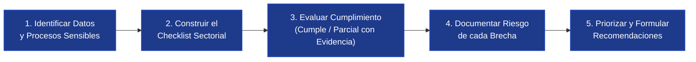

# 📄 Informe Técnico del Taller 6: Checklist de Cumplimiento Normativo

**Taller 6 — Checklist de Cumplimiento Normativo y Diagnóstico Legal: Caso Ban100**  
*Dominio de Seguridad y Cumplimiento del MAE (MRAE v3.0 MinTIC): Auditoría Regulatoria de Ciberseguridad SFC (C.E. 008/2023), Habeas Data (Leyes 1581/2012 y 1266/2008), Comercio Electrónico (Ley 527/1999), Pagos Inmediatos Bre-B (ISO 20022) e ISO/IEC 27001:2022*

- **Santiago Barrera Rueda**
- **Krish Purmessur Moros**
- **Samuel Guerrero Arcos**

**Fecha de Entrega:** 12 de Septiembre de 2026  
**Curso:** Arquitectura Empresarial (AREM) — Universidad de La Sabana  
**Libro de Matriz Oficial (Excel):** [`checklist-cliente.xlsx`](checklist-cliente.xlsx)  
**Documento de Fuentes y Normativa:** [`referencias.md`](referencias.md)

---

## 1. Descripción General del Trabajo

El presente taller tiene como propósito fundamental ejecutar una **evaluación formal, verificable y rigurosa del cumplimiento normativo, legal y regulatorio** sobre la arquitectura de la **Plataforma Digital de Ban100** (Establecimiento Bancario Comercial supervisado por la Superintendencia Financiera de Colombia - SFC, que atiende a más de **250.000 clientes activos** en más de **900 municipios del país**).

A diferencia de un ejercicio genérico de lista de verificación, este trabajo aplica la **metodología de 5 pasos de AREM**, articulando los dominios de negocio, información, aplicaciones e infraestructura desarrollados en los Talleres 0 al 5 con el complejo ecosistema normativo de la banca colombiana. Ban100 procesa información de máxima sensibilidad institucional:
1. **Datos personales y demográficos** de población vulnerable (pensionados de la tercera edad y microempresarios de sectores no bancarizados).
2. **Datos sensibles biométricos** (vectores faciales y pruebas de vida bajo estándar iBeta Nivel 2).
3. **Datos financieros y crediticios reservados** (capacidad de endeudamiento, mesadas pensionales y scores de riesgo).
4. **Títulos ejecutivos desmaterializados** (pagarés de libranza custodiados en DECEVAL bajo la Ley 527 de 1999).
5. **Transacciones monetarias en tiempo real** interoperables a través del nuevo sistema **Bre-B** del Banco de la República bajo el estándar internacional **ISO 20022**.

El resultado final se consolida en el libro oficial [`checklist-cliente.xlsx`](checklist-cliente.xlsx), compuesto por la hoja principal **Checklist General** (22 controles auditados bajo los únicos estados normativos permitidos: `✅ Cumple` y `⚠️ Parcial`) y la hoja derivada **Brechas Identificadas** (7 deficiencias reales con análisis de impacto legal/operativo y plan de acción priorizado).

---

## 2. Proceso de Desarrollo (Metodología en 5 Pasos)

Para garantizar un diagnóstico objetivo y con valor arquitectural para el banco, se siguió estrictamente la metodología de 5 pasos establecida en la guía del curso:

---

### Paso 1 — Identificación de Datos y Procesos Sensibles de Ban100

A partir del Modelo de Información (ERD del Taller 2), los Contenedores C4 (Taller 3), el Mapa de Infraestructura (Taller 4) y el Modelado de Amenazas STRIDE (Taller 5), se catalogaron los activos de datos y procesos más críticos de Ban100 frente al marco legal aplicable:

| N° | Activo de Información / Proceso | Naturaleza y Nivel de Sensibilidad | Normativa Primaria Aplicable | Justificación Legal y Regulatoria |
|:---:|---|---|---|---|
| **1** | Datos de Identificación y Contacto (`CLIENTE`: Cédula, Nombres, Celular, Dirección) | **Dato Personal General** | **Ley 1581 de 2012** (Habeas Data) | Información sujeta a principios de finalidad, libertad y veracidad; exige autorización informada y derechos ARCO. |
| **2** | Biometría Facial y Pruebas de Vida (`Truora`: Vectores faciales, Selfies pasivas) | **Dato Sensible** (Máxima reserva) | **Ley 1581 de 2012** (Art. 6) y **C.E. 008/2023 SFC** | Su tratamiento es excepcional; exige advertencia de carácter facultativo y medidas de cifrado reforzadas. |
| **3** | Información Crediticia y Capacidad de Endeudamiento (`scoring_crediticio`, mora) | **Dato Financiero y Comercial Reservado** | **Ley Estatutaria 1266 de 2008** y **Circular Básica Jurídica SFC** | Regula la caducidad del dato negativo, consulta previa en centrales (TransUnion/Datacrédito) y reserva bancaria. |
| **4** | Saldos y Mesadas Pensionales (`CUENTA_DEPOSITO`, Cupo de Libranza) | **Dato Financiero Confidencial** | **Estatuto Orgánico del Sistema Financiero (EOSF)** y **C.E. 008/2023 SFC** | Reserva bancaria absoluta frente a terceros no autorizados; prohíbe exposición en interfaces abiertas. |
| **5** | Pagarés Digitales Desmaterializados (`CREDITO_LIBRANZA`, `hash_firma_truora`) | **Título Valor Ejecutivo Digital** | **Ley 527 de 1999**, **Decreto 2364/2012** y **Custodia DECEVAL** | Exige equivalencia funcional, inalterabilidad probatoria y estampa cronológica certificada (*Time-stamping*). |
| **6** | Catálogo de Llaves Bre-B (`LLAVE_BRE_B`: Celular, Cédula, Correo asociado a Cuenta) | **Dato de Interoperabilidad Financiera** | **Circular Reglamentaria DSP-2023 BanRep** | Registro único en el Directorio Central de BanRep para enrutamiento seguro de pagos inmediatos 24/7. |
| **7** | Mensajería Transaccional ISO 20022 (`TRANSACCION_BRE_B`: `pacs.008`, `pacs.002`) | **Mensaje Financiero Estándar Nacional** | **Circular DSP-2023 BanRep** y **C.E. 008/2023 SFC** | Liquidación bruta en tiempo real; exige integridad de payload, no repudio y trazabilidad en segundos. |
| **8** | Pistas de Auditoría Forense (`LOG_AUDITORIA_SEGURIDAD`: IP, Geoloq, MFA, Hash WORM) | **Evidencia Digital Regulatoria** | **Circular Externa 008 de 2023 SFC** (Capítulo I) | Obligatoriedad de registros inmutables con sincronización horaria NTP para trazabilidad forense. |
| **9** | Intercambio de Cupos con Pagadurías (Convenios con Fondos de Pensiones / Estado) | **Dato Operativo Interinstitucional** | **Circular Externa 007/2018 SFC** (SARO) y **Ley 1581/2012** | Gestión del riesgo operativo en canales compartidos y secreto del convenio de descuento por nómina. |
| **10** | Repositorio Analítico y Telemetría de Fraude (Data Lakehouse en Cloud) | **Información Agregada de Negocio y Riesgo** | **ISO/IEC 27001:2022** (Control A.8.11) y **RNBD SIC** | Tratamiento masivo en nube que requiere inscripción en el Registro Nacional de Bases de Datos ante la SIC. |

---

### Paso 2 — Construcción del Checklist por Categoría

Para cubrir integralmente tanto los estándares internacionales como las normativas financieras de Colombia, se estructuraron **22 criterios de auditoría** distribuidos en **7 dominios temáticos**:

1. **Consentimiento y Autorización (4 ítems):** Consentimiento informado web/móvil, autorización explícita para datos sensibles biométricos, autorización previa para consulta en centrales financieras (Ley 1266) y mecanismos de revocatoria ARCO.
2. **Seguridad de la Información - ISO/IEC 27001 y SFC (4 ítems):** Política formal SGSI, cifrado estricto en tránsito (TLS 1.3 / mTLS inter-servicios), cifrado en reposo (TDE AES-256 / HSM) y Plan de Continuidad BCP/DRP probado.
3. **Autenticación y Control de Acceso (4 ítems):** Autenticación Multifactor (MFA) contextual/adaptativa (C.E. 008 SFC), validación biométrica con prueba de vida certificada iBeta Nivel 2, autorización autoritativa Zero Trust (tokens JWT RS256) y principio Maker-Checker.
4. **Protección de Datos Personales (3 ítems):** Oficial de Protección de Datos (DPO) y gobierno de privacidad, inscripción/actualización en el Registro Nacional de Bases de Datos (RNBD SIC), y Enmascaramiento Dinámico de Datos (DDM) en consultas de terceros.
5. **Prevención de Fugas de Información (3 ítems):** Soluciones tecnológicas DLP en terminales, Centro de Operaciones de Seguridad (SOC 24/7) con analítica predictiva de fraude, y protección WAF elástica con cabeceras de endurecimiento HTTP (CSP).
6. **Trazabilidad y Auditoría Forense (2 ítems):** Pistas de auditoría inmutables WORM con encadenamiento SHA-256 y sincronización NTP (C.E. 008 SFC), y validez probatoria de títulos desmaterializados bajo la Ley 527 de 1999 custodiados en DECEVAL.
7. **Retención, Anonimización e Interoperabilidad (2 ítems):** Políticas de retención/purga automatizada de datos temporales biométricos, e interoperabilidad plena bajo el estándar ISO 20022 en el Sistema Bre-B.

---

### Paso 3 — Evaluación del Cumplimiento (Hoja 1: `Checklist General`)

Siguiendo la restricción metodológica oficial, cada control fue evaluado exclusivamente bajo dos niveles: **`✅ Cumple`** o **`⚠️ Parcial`**, aportando la evidencia técnica verificable documentada en los talleres arquitecturales previos:

| N° | Categoría | Criterio de Cumplimiento | Nivel de Cumplimiento | Evidencia Técnica / Justificación | Recomendación Arquitectural |
|:---:|---|---|:---:|---|---|
| **1** | Consentimiento | Consentimiento informado previo en canales digitales | **✅ Cumple** | Casilla mandatoria de aceptación de Términos, Condiciones y Política de Privacidad en formularios web y App (con timestamp e IP). | Detallar las finalidades específicas diferenciadas entre gestión de libranza y envío de ofertas comerciales. |
| **2** | Consentimiento | Autorización explícita para datos biométricos sensibles | **✅ Cumple** | Pantalla previa en Truora que notifica expresamente la captura de selfie facial y cotejo registraduría conforme a Ley 1581 (Art. 6). | Asegurar que el texto informe explícitamente el carácter facultativo de autorizar datos sensibles. |
| **3** | Consentimiento | Autorización para consulta en centrales financieras (Ley 1266) | **✅ Cumple** | Cláusula de consulta en TransUnion y Datacrédito integrada y firmada digitalmente en el paso de scoring crediticio. | Mantener trazabilidad de la constancia de autorización durante la vigencia de la obligación crediticia. |
| **4** | Consentimiento | Mecanismo digital accesible para revocatoria y derechos ARCO | **⚠️ Parcial** | La revocatoria se tramita por correo o formulario web de PQR; carece de un panel de autoservicio digital en la App móvil. | Implementar módulo de 'Gestión de Privacidad y Consentimientos' de autoservicio en Portal Web y App Ban100. |
| **5** | Seguridad ISO 27001 | Política formal de Seguridad y Ciberseguridad | **✅ Cumple** | Política aprobada por Junta Directiva, basada en ISO/IEC 27001:2022 y lineamientos de la C.E. 008/2023 de la SFC. | Revisar y actualizar semestralmente la matriz de riesgos operacionales y ciberseguridad. |
| **6** | Seguridad ISO 27001 | Cifrado estricto de información en tránsito | **✅ Cumple** | TLS 1.3 con suites fuertes (ECDHE-RSA-AES256-GCM-SHA384) en canales externos y mTLS con certificados X.509 en clúster K8s. | Automatizar la rotación de certificados mTLS inter-servicios mediante cert-manager en Kubernetes cada 90 días. |
| **7** | Seguridad ISO 27001 | Cifrado en reposo para bases de datos y almacenamiento | **✅ Cumple** | Transparent Data Encryption (TDE) AES-256 en BD Core Transaccional, base MDM y almacenamiento persistente en Cloud KMS. | Custodiar claves maestras de cifrado en Módulos de Seguridad de Hardware (HSM) dedicados (C.E. 008 SFC). |
| **8** | Seguridad ISO 27001 | Plan BCP/DRP formal probado con métricas RTO/RPO | **⚠️ Parcial** | Core Legacy en Bogotá es SPOF on-premise; failover de balanceador global no es automático (RTO > 5s en contingencia Bre-B). | Implementar balanceo global activo-activo multi-región con conmutación DNS en <30s y avanzar en Strangler Fig. |
| **9** | Autenticación y Acceso | MFA adaptativa/contextual para transacciones monetarias | **✅ Cumple** | Evaluación contextual (IP, geolocalización, huella) combinando biometría facial iBeta con OTP dinámico de 6 dígitos (120s caducidad). | Evolucionar hacia estándares FIDO2/WebAuthn para reducir dependencia de SMS en zonas de baja cobertura celular. |
| **10** | Autenticación y Acceso | Validación biométrica con prueba de vida certificada | **✅ Cumple** | Integración con Truora certificada iBeta Nivel 2 contra ataques de presentación / deepfakes y validación OCR PDF417 de cédula. | Monitorear tasas de falso rechazo en adultos mayores pensionados para optimizar la usabilidad del motor biométrico. |
| **11** | Autenticación y Acceso | Control RBAC/ABAC y modelo Backend-Authoritative | **✅ Cumple** | Tokens JWT firmados con clave privada RS256 validados independientemente en K8s; cálculos ejecutados 100% en servidor. | Implementar re-validación de scopes dinámicos para desembolsos que superen el promedio histórico del cliente. |
| **12** | Autenticación y Acceso | Principio de doble autorización (Maker-Checker) | **✅ Cumple** | Flujo de doble intervención en backoffice para créditos que requieran excepción de capacidad de endeudamiento o montos altos. | Enlazar criptográficamente los registros de Maker y Checker a la pista de auditoría inmutable WORM. |
| **13** | Protección de Datos | Oficial de Protección de Datos (DPO) formalmente designado | **✅ Cumple** | Oficial de Privacidad y CISO designados ante Alta Dirección y SIC, con comité mensual de seguimiento a tratamientos. | Fortalecer la participación del DPO en evaluaciones de impacto a la privacidad (PIA) de nuevas funciones cloud/IA. |
| **14** | Protección de Datos | Inscripción y actualización de bases de datos ante RNBD (SIC) | **⚠️ Parcial** | Bases históricas radicadas, pero falta actualizar novedades tras integrar el Data Lakehouse cloud y telemetría de Bre-B. | Ejecutar inventario de repositorios cloud y radicar formalmente las novedades técnicas ante el RNBD de la SIC. |
| **15** | Protección de Datos | Enmascaramiento Dinámico de Datos (DDM) en consultas | **⚠️ Parcial** | Enmascaramiento activo en frontend, pero adaptadores de pagadurías y microservicios internos procesan saldos en texto claro en persistencia. | Habilitar Dynamic Data Masking (DDM) a nivel de motor RDBMS y filtrar mesadas en logs operativos. |
| **16** | Prevención de Fugas | Soluciones de Prevención de Fugas de Datos (DLP) | **⚠️ Parcial** | Políticas escritas existentes, pero carece de herramienta tecnológica DLP que impida exportaciones masivas en puestos de sucursales. | Desplegar agente DLP corporativo con bloqueo de USB, marca de agua en pantalla y detección de patrones de cédulas. |
| **17** | Prevención de Fugas | SOC 24/7 y monitoreo antifraude financiero en tiempo real | **✅ Cumple** | SOC 24/7/365 con SIEM centralizado y analítica antifraude correlacionando eventos de canales, libranzas y Bre-B (C.E. 008 SFC). | Incorporar modelos de machine learning no supervisado para detección de patrones anómalos de dispersión en Bre-B. |
| **18** | Prevención de Fugas | Protección perimetral WAF y endurecimiento de cabeceras HTTP | **⚠️ Parcial** | WAF activo y cabeceras HSTS/nosniff operativas, pero análisis pasivo detectó ausencia de Content-Security-Policy (CSP) estricta. | Inyectar cabeceras Content-Security-Policy (CSP) estrictas en CDN y API Gateway prohibiendo scripts no autorizados. |
| **19** | Trazabilidad Forense | Pistas de auditoría inmutables WORM con encadenamiento | **✅ Cumple** | Entidad `LOG_AUDITORIA_SEGURIDAD` con NTP, encadenamiento SHA-256 y depósito WORM append-only (C.E. 008/2023 SFC). | Ejecutar pruebas periódicas de no repudio e integridad criptográfica de la cadena de auditoría ante auditores externos. |
| **20** | Trazabilidad Forense | Validez legal de pagarés desmaterializados (Ley 527/1999) | **✅ Cumple** | Pagaré de libranza con firma electrónica certificada, Time-stamping acreditado y custodia en el depósito de DECEVAL. | Verificar semestralmente la vigencia de certificados digitales y esquemas de consulta de tenencia con DECEVAL. |
| **21** | Retención e Interop. | Purga y anonimización automatizada de datos temporales | **⚠️ Parcial** | Retención contable de 10 años cumplida, pero no existe procedimiento automatizado de depuración de selfies y vectores de solicitudes desistidas. | Implementar políticas TTL en almacenamiento cloud para depurar datos biométricos de solicitudes desistidas a los 30 días. |
| **22** | Retención e Interop. | Interoperabilidad ISO 20022 en Sistema de Pagos Bre-B | **✅ Cumple** | Módulo Bre-B desacoplado con soporte nativo de mensajes `pacs.008`, `pacs.002` y `pain.001` sobre canal VPN IPsec con BanRep. | Mantener sincronizado el motor de parsing ISO 20022 con las actualizaciones que libere BanRep en esquemas XSD. |

* **Balance cuantitativo:** 22 controles auditados → **15 Cumple (68.2%)**, **7 Parcial (31.8%)**.

---

### Paso 4 — Documentación de Brechas e Impacto de Riesgo

Cada uno de los **7 controles evaluados como `⚠️ Parcial`** fue documentado en la hoja **Brechas Identificadas**, detallando su severidad y su impacto legal u operativo concreto:

1. **Brecha B1 (Consentimiento - Riesgo Medio):** Inexistencia de panel digital de autoservicio para revocatoria del consentimiento y ejercicio directo de derechos ARCO.
   * *Impacto Legal:* Riesgo de investigaciones y quejas ante la Delegatura de Protección de Datos de la SIC (Ley 1581 de 2012) por imponer barreras operativas al ciudadano; sobrecarga del canal de PQR.
2. **Brecha B2 (Seguridad ISO 27001 - Riesgo Alto):** Plan de continuidad DRP incompleto por SPOF en Core Legacy on-premise y failover manual del balanceador (RTO > 5s en contingencia Bre-B).
   * *Impacto Legal/Operativo:* Infracción del régimen de disponibilidad de la Circular Externa 008/2023 de la SFC; potencial exclusión o sanción del Banco de la República por exceder tiempos de respuesta en la cámara de liquidación de Bre-B; pérdida de operaciones financieras en días pico de mesadas pensionales.
3. **Brecha B3 (Protección de Datos - Riesgo Medio):** Desactualización del inventario de bases de datos ante el Registro Nacional de Bases de Datos (RNBD) de la SIC tras la integración del Lakehouse y telemetría de Bre-B.
   * *Impacto Legal:* Multas sucesivas de hasta 2.000 SMMLV impuestas por la SIC bajo el artículo 23 de la Ley 1581 de 2012 por omitir el registro de repositorios masivos en nube y transferencias internacionales de datos.
4. **Brecha B4 (Protección de Datos - Riesgo Alto):** Carencia de Enmascaramiento Dinámico de Datos (DDM) a nivel de motor de base de datos en interfaces de pagadurías y logs internos no forenses.
   * *Impacto Legal/Operativo:* Exposición indebida de saldos bancarios y mesadas de pensionados ante operadores internos o integraciones vulneradas; violación del secreto bancario e incumplimiento de directrices de seguridad de la información de la SFC.
5. **Brecha B5 (Prevención de Fugas - Riesgo Alto):** Ausencia de soluciones DLP corporativas en estaciones de asesores comerciales y puestos de backoffice en oficinas regionales.
   * *Impacto Legal/Operativo:* Riesgo inminente de exfiltración de bases de datos de clientes por empleados desleales (*insider threat*) para venta a terceros; daño reputacional masivo y sanciones drásticas de la SFC y SIC.
6. **Brecha B6 (Prevención de Fugas - Riesgo Medio):** Inexistencia de política estricta de Content-Security-Policy (CSP) en portales transaccionales y de captación.
   * *Impacto Legal/Operativo:* Vulnerabilidad frente a ataques de Cross-Site Scripting (XSS) y manipulación de scripts de terceros (*Web Skimming / Magecart*), lo que podría capturar credenciales o datos de originación en el navegador del cliente.
7. **Brecha B7 (Retención e Interoperabilidad - Riesgo Medio):** Ausencia de rutinas automatizadas de depuración y anonimización para datos biométricos temporales de solicitudes de libranza no concluidas o desistidas.
   * *Impacto Legal:* Retención injustificada de datos sensibles protegidos violando el principio de necesidad y temporalidad de la Ley 1581 de 2012.

---

### Paso 5 — Priorización y Plan de Acción Recomendado (Hoja 2: `Brechas Identificadas`)

Ponderando el nivel de riesgo legal, la severidad del impacto financiero y la viabilidad técnica de remediación, se estableció la matriz oficial de priorización:

| Categoría | Brecha Identificada | Riesgo | Recomendación Prioritaria | Nivel de Prioridad |
|---|---|:---:|---|:---:|
| **Seguridad (ISO 27001)** | Plan de continuidad (DRP) con puntos únicos de falla (SPOF): Core Legacy en Bogotá sin réplica activa en Medellín y failover manual de balanceador (RTO > 5s en Bre-B). | **Alto** | Desplegar balanceo global activo-activo multi-región con failover DNS en <30s y acelerar la descomposición del Core Legacy mediante el patrón Strangler Fig y réplica activa en contingencia. | **Alta** |
| **Protección de Datos** | Carencia de Enmascaramiento Dinámico de Datos (DDM) a nivel de motor de base de datos en interfaces de convenios de pagadurías y logs operativos internos. | **Alto** | Habilitar políticas nativas de Dynamic Data Masking (DDM) en el motor de base de datos relacional y aplicar filtros criptográficos en los adaptadores de convenios con pagadurías. | **Alta** |
| **Prevención de Fugas** | Ausencia de soluciones de Prevención de Fugas de Datos (DLP) para bloquear la exportación no autorizada de bases de datos de pensionados en puestos comerciales. | **Alto** | Implementar solución corporativa de DLP en estaciones de asesores comerciales con bloqueo de puertos USB, marca de agua digital en pantalla y detección de patrones de cédulas. | **Alta** |
| **Consentimiento** | Inexistencia de portal digital de autoservicio para revocatoria del consentimiento y ejercicio de derechos ARCO, dependiendo de trámites manuales vía PQR. | **Medio** | Desarrollar e integrar módulo de 'Gestión de Privacidad y Derechos ARCO' en el Portal Web y App Ban100 con sincronización automática en tiempo real hacia el MDM. | **Media** |
| **Protección de Datos** | Desactualización del inventario de bases de datos registradas en el RNBD de la SIC tras la integración del repositorio analítico Lakehouse en nube y telemetría de Bre-B. | **Medio** | Efectuar auditoría de repositorios de datos cloud y radicar formalmente las novedades técnicas, responsables y transferencias internacionales ante el RNBD de la SIC. | **Media** |
| **Prevención de Fugas** | Inexistencia de políticas estrictas de Content-Security-Policy (CSP) en portales transaccionales y de captación, permitiendo vectores de inyección de scripts (XSS). | **Medio** | Configurar e inyectar encabezados estrictos de Content-Security-Policy (CSP) en la capa de CDN y API Gateway, restringiendo la carga de JavaScript exclusivamente a orígenes verificados. | **Media** |
| **Retención e Interop.** | Inexistencia de un procedimiento automatizado de depuración y anonimización para datos biométricos temporales de solicitudes de libranza no concluidas o desistidas. | **Medio** | Configurar políticas de ciclo de vida de objetos (TTL) en almacenamiento cloud para eliminar o anonimizar datos biométricos de solicitudes desistidas tras 30 días calendario. | **Media** |

---

## 3. Análisis del Modelo Propuesto y Supuestos de Arquitectura

### 3.1 Trazabilidad Integral con los Talleres Previos
El diagnóstico normativo no es una pieza aislada, sino el puente directo que evalúa la madurez de las soluciones construidas en los talleres anteriores:
- **Taller 1 (BPMN):** El flujo modelado de *Originación y Desembolso de Libranza* incorpora las compuertas decisionales donde actúan las autorizaciones de la Ley 1581 (Paso 1) y el depósito del pagaré desmaterializado en DECEVAL (Paso 20).
- **Taller 2 (ERD):** Las entidades `CLIENTE`, `CREDITO_LIBRANZA`, `LLAVE_BRE_B` y `LOG_AUDITORIA_SEGURIDAD` sustentan la evidencia técnica del cifrado en reposo (Paso 7) y la inmutabilidad de logs WORM (Paso 19).
- **Taller 3 (C4):** La delimitación entre canales digitales, API Gateway, microservicios K8s y persistencia demuestra la aplicación de RBAC/ABAC y tokens JWT asimétricos RS256 (Paso 11).
- **Taller 4 (Infraestructura):** El mapa de topología multi-región fundamentó la identificación de la brecha crítica en el plan DRP (Paso 8), detectando el cuello de botella del Core Legacy y el RTO de Bre-B.
- **Taller 5 (STRIDE):** Las amenazas modeladas de *Tampering* en Bre-B (T2) e *Information Disclosure* en consultas de convenios (T4) se alinean unívocamente con las brechas de Enmascaramiento DDM (Paso 15) y DLP (Paso 16).

### 3.2 Supuestos Asumidos
1. **Vigilancia Financiera Estricta:** Se asume que toda falla de disponibilidad mayor a 5 minutos en el subsistema de pagos Bre-B es causal de reporte obligatorio ante la SFC y BanRep.
2. **Entornos de Nube Híbrida:** La infraestructura en nube pública opera bajo el modelo de responsabilidad compartida; Ban100 es jurídicamente responsable de la configuración de claves (Cloud KMS), control de accesos y cifrado de los datos.
3. **Población Vulnerable:** Dado que el 70% de los usuarios de libranza son pensionados de la tercera edad, las medidas de revocatoria del consentimiento (ARCO) y validación biométrica deben garantizar una alta usabilidad y evitar exclusión digital.

---

## 4. Vista ArchiMate Equivalente (Capa de Motivación y Restricciones)

Conforme a los estándares de modelado arquitectural (MRAE v3.0 y TOGAF), cada brecha identificada en el checklist se traduce en un elemento de motivación de tipo **Constraint** (Restricción legal o normativa ineludible) que restringe y condiciona los procesos de negocio y los componentes de software:

```mermaid
flowchart TD
    subgraph motivacion["Capa de Motivación (Restricciones Normativas)"]
        C1(["⛔ C1: Autoservicio Derechos ARCO\n(Ley 1581 / SIC)"])
        C2(["⛔ C2: Resiliencia DRP RTO < 30s\n(Circular 008 SFC / BanRep)"])
        C3(["⛔ C3: Actualización Continua RNBD\n(Ley 1581 Art. 25)"])
        C4(["⛔ C4: Dynamic Data Masking en BD\n(Circular 008 / Reserva Bancaria)"])
        C5(["⛔ C5: Control de Fugas DLP\n(ISO 27001 Control A.8.12)"])
        C6(["⛔ C6: Content-Security-Policy Estricto\n(OWASP / Ciberdefensa SFC)"])
        C7(["⛔ C7: Purga Automatizada Biometría TTL\n(Ley 1581 Principio Necesidad)"])
    end

    subgraph negocio["Capa de Negocio (Procesos Afectados)"]
        B_P1["📋 Proceso de Gestión de PQR y Privacidad"]
        B_P2["💳 Proceso Misional Originación de Libranza"]
        B_P3["⚡ Proceso de Pagos Inmediatos Bre-B 24/7"]
        B_P4["🤝 Proceso de Validación con Pagadurías"]
    end

    subgraph aplicacion["Capa de Aplicación y Tecnología (Componentes Afectados)"]
        A_C1["📱 App Móvil & Portal Web Transaccional"]
        A_C2["🌐 API Gateway Institucional & CDN"]
        A_C3["⚙️ Core Bancario Legacy & BD Transaccional"]
        A_C4["🗄️ Repositorio Analítico Lakehouse Cloud"]
        A_C5["💻 Estaciones de Trabajo de Asesores Comerciales"]
    end

    C1 -.->|"restringe"| B_P1
    C1 -.->|"restringe"| A_C1

    C2 -.->|"restringe"| B_P3
    C2 -.->|"restringe"| A_C3

    C3 -.->|"restringe"| A_C4

    C4 -.->|"restringe"| B_P4
    C4 -.->|"restringe"| A_C3

    C5 -.->|"restringe"| A_C5

    C6 -.->|"restringe"| A_C2
    C6 -.->|"restringe"| A_C1

    C7 -.->|"restringe"| B_P2
    C7 -.->|"restringe"| A_C4

    classDef motivacion fill:#e0e7ff,color:#1e3a8a,stroke:#3730a3,stroke-width:2px;
    classDef negocio fill:#fef3c7,color:#92400e,stroke:#b45309,stroke-width:2px;
    classDef aplicacion fill:#e0f2fe,color:#0369a1,stroke:#0284c7,stroke-width:2px;

    class C1,C2,C3,C4,C5,C6,C7 motivacion;
    class B_P1,B_P2,B_P3,B_P4 negocio;
    class A_C1,A_C2,A_C3,A_C4,A_C5 aplicacion;
```

> **Conexión con el Taller 7 (Opportunities & Solutions):**  
> Estas 7 restricciones constituyen los insumos formales para el **Análisis de Brechas (Gap Analysis)**. En el Taller 7, cada restricción originará un paquete de trabajo (*Work Package*) dentro de la hoja de ruta de transición del estado actual (AS-IS) hacia la arquitectura objetivo (TO-BE).

---

## 5. Investigación Complementaria: Normatividad Bancaria y Regulatoria en Colombia

### 5.1 Circular Externa 008 de 2023 de la Superintendencia Financiera de Colombia (SFC)
La Circular 008 de 2023 redefinió de manera obligatoria las reglas de juego para la gestión del riesgo de ciberseguridad y seguridad de la información en el sector financiero colombiano. Sus pilares más estrictos y su impacto sobre Ban100 son:
- **Autenticación Fuerte Multifactor Adaptativa:** Prohíbe de manera tajante el uso exclusivo de contraseñas estáticas para la realización de operaciones monetarias remotas. Exige la correlación en tiempo real de al menos dos factores independientes (inherencia biométrica y posesión dinámica OTP) ponderados según el perfil de riesgo y contexto transaccional del cliente.
- **Pistas de Auditoría Forense Inmutables:** Los registros de auditoría no pueden ser tratados como simples logs de texto rotativos. Deben cumplir con esquemas de inmutabilidad comprobable (tecnología WORM o sellado criptográfico), sincronización con servidores de hora oficiales (NTP) y disponibilidad inmediata para peritajes judiciales y visitas de inspección de la SFC.
- **Monitoreo Continuo 24/7/365:** Exige la operación ininterrumpida de capacidades de detección analítica que analicen el tráfico transaccional en tiempo real para alertar desvíos de comportamiento y posibles patrones de fraude electrónico.

### 5.2 Régimen Dual de Protección de Datos: Ley 1581 de 2012 vs. Ley Estatutaria 1266 de 2008
En una entidad bancaria confluyen dos regímenes de Habeas Data con alcances y autoridades de supervisión diferenciadas:
1. **Ley 1581 de 2012 (Supervisada por la SIC):** Gobierna los datos personales generales y sensibles (datos biométricos, fotografías, registros de geolocalización). Exige el consentimiento previo, expreso e informado, impone el Registro Nacional de Bases de Datos (RNBD) y garantiza los derechos ARCO.
2. **Ley Estatutaria 1266 de 2008 (Supervisada por la SFC y SIC):** Regula el Habeas Data Financiero y Crediticio. Establece reglas estrictas sobre el término de caducidad del dato negativo (la sanción no puede exceder el doble de la mora ni un máximo de 4 años tras el pago) y exige la autorización previa y expresa para consultar y reportar información a centrales de riesgo crediticio (TransUnion, Datacrédito).

### 5.3 Desmaterialización y Firma Electrónica bajo la Ley 527 de 1999
Para que un crédito de libranza otorgado en 15 minutos de forma digital tenga fuerza ejecutiva de cobro ante los jueces de la República sin requerir papel físico, Ban100 debe cumplir rigurosamente con los postulados de la Ley 527 de 1999 y el Decreto 2364 de 2012:
- **Equivalencia Funcional:** La firma electrónica emitida a través del aliado tecnológico (Truora) debe asociar de forma unívoca al firmante con el mensaje de datos del pagaré mediante certificados digitales X.509.
- **Estampado Cronológico Certificado (*Time-Stamping*):** Permite demostrar con certeza jurídica indiscutible el instante exacto en que el deudor asumió la obligación crediticia.
- **Custodia en Depósito Centralizado (DECEVAL):** Asegura el principio de "circulación y tenencia única" del título valor, impidiendo la duplicidad del pagaré digital o su cobro simultáneo indebido.

### 5.4 Adopción Obligatoria del Estándar ISO 20022 en el Sistema Bre-B (Banco de la República)
La reglamentación del Sistema de Pagos Inmediatos Interoperables de Colombia (Circular Reglamentaria Externa DSP-2023) exige a todas las entidades financieras conectarse mediante el estándar universal **ISO 20022**. A diferencia de los formatos planos tradicionales de compensación ACH:
- Los mensajes `pacs.008` (transferencia interbancaria) y `pacs.002` (confirmación transaccional) utilizan esquemas XML/JSON con tipificación de datos estricta.
- Permiten transportar metadatos enriquecidos de trazabilidad, motivos de liquidación y llaves alfanuméricas.
- Exigen latencias transaccionales extremas (tiempos de respuesta inferiores a 3 segundos de punta a punta), lo cual condiciona directamente la arquitectura de microservicios y la resiliencia DRP de Ban100.

---

## 6. Referencias

Para consultar la totalidad del soporte documental, legal, regulatorio y metodológico utilizado en este taller, consulte el archivo independiente:
👉 [`referencias.md`](referencias.md)

---

_Este informe técnico hace parte integral de la entrega del Taller 6 del curso de Arquitectura Empresarial (AREM) — Facultad de Ingeniería, Universidad de La Sabana._
