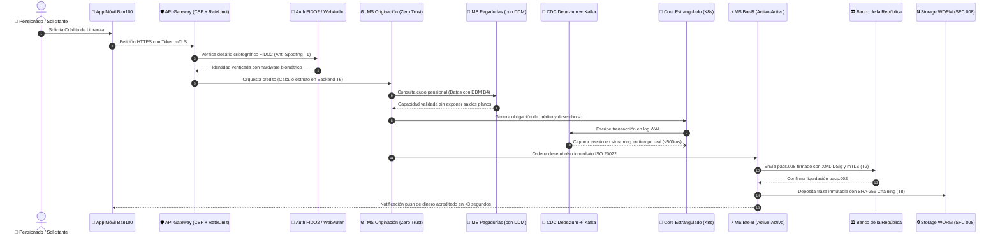
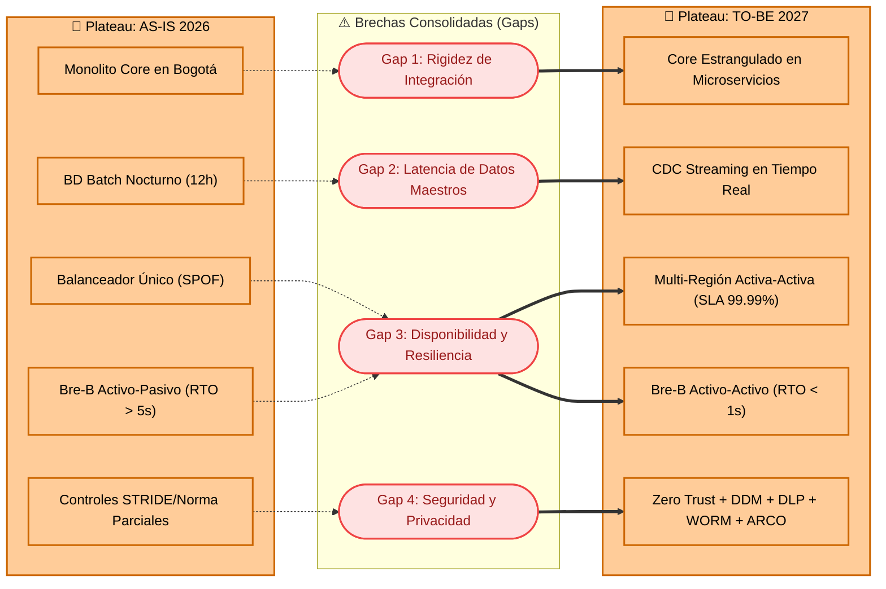

# 📄 Mejora de Arquitectura (TO-BE) — Identificación y Priorización de Mejoras

**Ban100** (Establecimiento Bancario Comercial, anteriormente Credifinanciera S.A.)  
*Especialista en inclusión financiera, crédito de libranza para pensionados y microcrédito productivo en más de 900 municipios de Colombia.*

- **Santiago Barrera Rueda**
- **Krish Purmessur Moros**
- **Samuel Guerrero Arcos**

**Fecha:** 12 de Septiembre de 2026  
**Curso:** Arquitectura Empresarial (AREM) — Universidad de La Sabana  
**Docente:** César Vega  
**Entregable Oficial:** Actividad de Mejora de Arquitectura (Fase E: Opportunities & Solutions — TOGAF ADM / MRAE v3.0 MinTIC)

---

## 1. Diagnóstico Inicial con preguntas orientadoras

El presente diagnóstico consolida de manera fidedigna la evidencia técnica, operacional, de seguridad y regulatoria levantada durante las fases previas de la arquitectura de Ban100 (**Taller 3 — Arquitectura de Aplicaciones C4**, **Taller 4 — Mapa de Infraestructura y Diagnóstico**, **Taller 5 — Evaluación de Seguridad STRIDE** y **Taller 6 — Cumplimiento Normativo y Protección de Datos**). Ningún hallazgo ha sido inventado; cada elemento responde a hechos documentados en la operación bancaria.

#### ¿Cuáles son los procesos o tecnologías que generan mayor fricción en la operación?
1. **Core Bancario Legacy Monolítico (Taller 4 - INF-1):** Alojado en el centro de datos on-premise de Bogotá, carece de interfaces de programación de aplicaciones (APIs) modernas. Toda integración con canales digitales o nuevos productos requiere desarrollos punto a punto costosos y rígidos, frenando el desacoplamiento proyectado en la hoja de ruta.
2. **Base de Datos Transaccional con Procesamiento Batch Nocturno (Taller 4 - INF-2):** La sincronización de estados de cuenta, movimientos de cartera y el catálogo local de Llaves del Sistema de Pagos Inmediatos Bre-B depende de ejecuciones por lotes cada 12 horas. Esto genera que los clientes perciban saldos desactualizados durante la noche y restringe la inmediatez transaccional 24/7 exigida por el Banco de la República.
3. **Puntos Únicos de Falla (SPOF) en el Borde y Core (Taller 4 - INF-3 / Taller 6 - B2):** La presencia de un balanceador de carga perimetral en instancia única y la ausencia de réplicas activas del Core en la región secundaria de contingencia (Medellín) exponen a los 250.000 clientes a una interrupción total del servicio si ocurre una falla física o lógica en Bogotá.

#### ¿Qué problemas recurrentes señalaron los usuarios o el cliente en las entrevistas?
1. **Trámites Manuales y Demoras en Derechos de Privacidad (Taller 6 - B1 / NOR-1):** Los pensionados y clientes no cuentan con un mecanismo digital de autoservicio para revocar su consentimiento de tratamiento de datos o ejercer sus derechos de Actualización, Rectificación, Cancelación y Oposición (ARCO). Dependen de solicitudes presenciales o PQRs por correo electrónico, con tiempos de respuesta que promedian 15 días hábiles, sobrecargando las mesas de servicio y arriesgando sanciones ante la SIC.
2. **Interrupción y Rechazos de Transferencias Inmediatas (Taller 4 - INF-4):** Durante ventanas de contingencia o micro-cortes de red, el conmutador de la réplica pasiva de Bre-B tarda más de 5 segundos en activarse (RTO > 5s), ocasionando timeouts en la cámara de compensación central y rechazos automáticos de transferencias de mesadas pensionales.
3. **Parálisis de Originación en Contingencia (Taller 4 - INF-5):** En caso de degradación de la sede Bogotá, la fuerza comercial en municipios rurales no puede radicar créditos de libranza ni aperturas de CDT porque la región Medellín solo aloja servicios básicos de consulta, dejando al banco comercialmente inoperante.

#### ¿Qué vulnerabilidades de seguridad o riesgos quedaron evidenciados en el análisis previo?
1. **Suplantación de Identidad por Deepfakes y Ataques de Presentación (Taller 5 - T1 / STR-1):** La validación biométrica actual y el OTP mediante SMS convencional resultan vulnerables ante inyección de video sintético y SIM swapping, arriesgando fraudes crediticios contra adultos mayores.
2. **Ausencia de Firma Digital en Mensajería Bre-B en Tránsito (Taller 5 - T2 / STR-2):** Aunque existe túnel VPN, los mensajes ISO 20022 (`pacs.008`) no cuentan con firma digital de payload XML-DSig con certificados X.509 clase 3 antes de salir de la red interna, posibilitando manipulación de cuentas destino por malware o atacantes en tránsito (*Tampering*).
3. **Vulnerabilidad de Repudio Legal en Pagarés (Taller 5 - T3 / STR-3):** La aceptación mediante checkbox web y registro simple de IP deja desprotegido judicialmente el cobro ejecutivo de la cartera ante demandas de deudores, comprometiendo además los convenios de titularización de cartera con BTG Pactual (>$500kM COP).
4. **Exposición de Datos Sensibles en Convenios de Pagadurías (Taller 5 - T4 / Taller 6 - B4):** La carencia de Enmascaramiento Dinámico de Datos (DDM) a nivel de motor de base de datos permite que personal operativo y adaptadores de nómina observen montos pensionales y saldos en texto claro.
5. **Riesgo Inminente de Fuga Masiva de Datos por Insiders (Taller 6 - B5 / NOR-5):** Los puestos de trabajo de asesores comerciales carecen de agentes Endpoint DLP, facilitando la extracción indebida de bases de pensionados hacia memorias USB o correos no corporativos.
6. **Inyección de Scripts y Vulnerabilidad Web Skimming (Taller 6 - B6 / NOR-6):** La ausencia de cabeceras estrictas de Content-Security-Policy (CSP) en portales web expone las credenciales de clientes ante posibles ataques de Cross-Site Scripting (XSS).
7. **Retención Indefinida de Biometría Desistida (Taller 6 - B7 / NOR-7):** No existe purga automatizada (TTL) para vectores faciales de solicitudes abandonadas, violando el principio de necesidad y temporalidad de la Ley 1581 de 2012.

---

## 2. Propuesta de Mejoras

Para cerrar la totalidad de las brechas diagnosticadas sin incurrir en soluciones improvisadas, se aplicó una metodología de dos fases: primero una lluvia de ideas sin censura inicial que abarca procesos, canales, seguridad y tecnología, y posteriormente una priorización estratégica en tres horizontes temporales de madurez arquitectural.

### 2.1 Lluvia de Ideas (Sin Censura Inicial)

Se generaron **12 iniciativas de mejora** orientadas a resolver las fricciones de negocio, riesgos de seguridad y brechas normativas:

| # | Idea de Mejora | Tipo | Brechas Asociadas | Descripción Resumida |
|:---:|---|:---:|:---:|---|
| **1** | **Balanceador Global Cloud Activo-Activo Multi-Región** | Tecnología | INF-3, NOR-2 | Reemplazar la instancia única del balanceador por un esquema Anycast multi-región con conmutación por DNS global en menos de 30 segundos. |
| **2** | **Change Data Capture (CDC) en Tiempo Real con Debezium y Kafka** | Tecnología | INF-2 | Capturar transacciones desde los transaction logs de la BD Core e inyectarlas en streaming continuo hacia Kafka, alimentando el MDM y Bre-B en tiempo real. |
| **3** | **Descomposición del Core Bancario mediante Patrón Strangler Fig** | Tecnología | INF-1 | Migrar progresivamente los módulos de cartera y depósitos hacia microservicios en Kubernetes, manteniendo fachadas de integración sin downtime. |
| **4** | **Módulo Bre-B Activo-Activo con Geo-Replicación Kafka MirrorMaker 2** | Tecnología | INF-4, NOR-2 | Replicar el motor de pagos y catálogo de llaves entre Bogotá y Medellín con sincronización sub-segundo, alcanzando RTO < 1s y RPO = 0. |
| **5** | **Kubernetes Federation (KubeFed) para Paridad Multi-Región** | Tecnología | INF-5 | Desplegar el stack completo de microservicios de originación y captación en la región secundaria, habilitando atención continua ante catástrofes. |
| **6** | **Módulo de Autoservicio de Privacidad y Derechos ARCO** | Proceso / Funcional | NOR-1 | Integrar en la App Móvil y Portal Web un componente digital para la revocatoria y consulta de consentimientos con orquestación directa al MDM. |
| **7** | **Dynamic Data Masking (DDM) y Cifrado TDE en Motores de Base de Datos** | Seguridad / Tecnología | STR-4, NOR-4 | Implementar enmascaramiento dinámico a nivel de motor SQL para campos de salario y saldo, y cifrado AES-256 en reposo (TDE). |
| **8** | **Despliegue de Agente Corporativo Endpoint DLP** | Seguridad / Proceso | NOR-5 | Instalar agentes de prevención de fuga en estaciones de asesores comerciales con bloqueo de puertos USB, marcas de agua y detección de cédulas. |
| **9** | **Inyección de Cabeceras CSP Estrictas y Rate Limiting en Borde** | Seguridad | STR-5, NOR-6 | Inyectar cabeceras HTTP (CSP, HSTS, X-Frame-Options) en CDN/WAF y configurar rate limiting adaptativo con circuit breakers Resilience4j. |
| **10** | **Políticas de Ciclo de Vida Automatizado (TTL = 30 días) para Biometría** | Cumplimiento / Tecnología | NOR-7 | Configurar reglas de purga y anonimización automática en buckets de almacenamiento cloud para datos biométricos de solicitudes desistidas. |
| **11** | **Biometría iBeta Nivel 2 + Enrolamiento FIDO2 / WebAuthn** | Seguridad | STR-1 | Incorporar pruebas de vida pasivas certificadas y autenticación criptográfica hardware-backed en el dispositivo móvil del pensionado. |
| **12** | **Pagaré Desmaterializado con Firma Digital y Custodia DECEVAL** | Legal / Proceso / Seguridad | STR-3 | Emitir pagarés electrónicos con estampado cronológico bajo Ley 527 de 1999 y radicación automática vía API en DECEVAL. |

### 2.2 Priorización Estratégica (Horizontes H1, H2 y H3)

De las 12 ideas generadas, se estructuró una priorización técnica basada en la matriz de **Impacto vs. Esfuerzo**, dividida en tres horizontes complementarios para asegurar victorias tempranas (*Quick Wins*) mientras se construyen las capacidades estructurales de largo plazo:

| Solución Priorizada | Esfuerzo | Impacto | Horizonte | Justificación Técnica y de Negocio | Brechas que Cierra |
|---|:---:|:---:|:---:|---|:---:|
| **Paquete 1: Resiliencia Perimetral y Cumplimiento Ágil** | Bajo - Medio | Alto | **H1: Quick Wins (0 a 3 meses)** | Cierra vulnerabilidades críticas de borde sin tocar el core. La inyección de CSP y Rate Limiting previene caídas en días de pago de pensiones y ataques web; el balanceador multi-región elimina el SPOF principal; y las políticas de TTL y RNBD eliminan el riesgo de sanciones inminentes de la SIC. | INF-3, STR-5, STR-7, NOR-3, NOR-6, NOR-7 |
| **Paquete 2: Ciberseguridad Zero Trust, Privacidad y CDC** | Medio | Crítico | **H2: Mediano Plazo (3 a 6 meses)** | Blinda el activo de información del banco. El CDC elimina el desfase de 12 horas conectando la BD a Kafka; FIDO2 y la firma ISO 20022 erradican el fraude por suplantación y alteración de giros; DDM y DLP protegen la base de pensionados; y el portal ARCO automatiza el cumplimiento de Habeas Data. | INF-2, STR-1, STR-2, STR-3, STR-4, STR-6, STR-8, NOR-1, NOR-4, NOR-5 |
| **Paquete 3: Modernización del Core y Resiliencia Total** | Alto | Crítico | **H3: Largo Plazo (6 a 12 meses)** | Solución definitiva a la rigidez y riesgo de continuidad del banco. Descompone el monolito mediante Strangler Fig sin interrumpir la operación; logra disponibilidad continua 24/7 en Bre-B (RTO < 1s) mediante réplicas geo-distribuidas; y garantiza paridad operativa total en la región Medellín. | INF-1, INF-4, INF-5, NOR-2 |

---

## 3. Visualización TO-BE

La arquitectura objetivo (**TO-BE**) extiende de forma coherente los modelos de los Talleres 3 (C4 Contenedores) y 4 (Mapa de Infraestructura), incorporando de manera nativa los controles de seguridad del Taller 5 y los requerimientos de cumplimiento del Taller 6.

### 3.1 Proceso Mejorado: Originación Digital y Desembolso Seguro Bre-B

El flujo transaccional misional se transforma eliminando las validaciones débiles y la dependencia de procesamiento por lotes:

### 3.2 Cambios en Aplicaciones, Infraestructura y Flujos de Información

#### Modelo TO-BE de Aplicaciones (Extensión C2)
El archivo editable [`to-be-aplicaciones-final.drawio`](to-be-aplicaciones-final.drawio) documenta las siguientes adiciones estructurales:
- **🆕 Módulo de Privacidad y Derechos ARCO (`cnt_arco`):** Microfrontend omnicanal en App y Web para revocatoria y consulta ciudadana.
- **🆕 Servidor FIDO2 / WebAuthn (`cnt_fido`):** Servicio de autenticación criptográfica asimétrica integrado con Truora.
- **🆕 Pipeline Change Data Capture (`ms_cdc`):** Motor Debezium sobre Kafka Connect para eliminar el batch nocturno.
- **🆕 Módulo Bre-B Réplica Activa en Medellín (`ms_breb_med`):** Instancia paralela sincronizada con MirrorMaker 2 (RTO < 1s).
- **🆕 Repositorio WORM Inmutable (`db_worm`):** Almacenamiento seguro con encadenamiento SHA-256 para auditoría Circular 008 SFC.
- **🆕 Bucket con Políticas TTL (`db_ttl`):** Purga automática a 30 días de fotos y biometría de solicitudes no perfeccionadas.

#### Modelo TO-BE de Tecnología (Extensión Mapa Infraestructura)
El archivo editable [`to-be-tecnologia-final.drawio`](to-be-tecnologia-final.drawio) resuelve los 5 riesgos del Taller 4 marcándolos en verde con resolución explícita:
- **✅ Balanceador Global Activo-Activo Cloud (`z2_3`):** Anycast DNS con health checks continuos y failover < 30s (resuelve INF-3).
- **✅ Pipeline CDC Streaming (`z3_cdc`):** Reemplazo del lote nocturno por captura continua de transacciones (resuelve INF-2).
- **✅ Core Bancario Estrangulado (`z3_8`):** Microservicios de cartera desacoplados en Kubernetes (resuelve INF-1).
- **✅ Módulo Bre-B Activo-Activo (`z4_3`):** Geo-replicación continua con RTO < 1s y RPO = 0 en Medellín (resuelve INF-4).
- **✅ Kubernetes Federation Multi-Región (`z4_2`):** Paridad de microservicios misionales en ambas regiones (resuelve INF-5).
- **✅ Endpoint DLP Corporativo (`z6_dlp`):** Protección en puestos de trabajo de asesores y sucursales (resuelve NOR-5).

### 3.3 Matriz de Controles de Seguridad Integrados en el TO-BE

En cumplimiento de los lineamientos del curso, la arquitectura objetivo incorpora explícitamente las mitigaciones de las 8 amenazas STRIDE del Taller 5 y las 7 brechas normativas del Taller 6:

| Amenaza / Brecha Origen | Componente TO-BE que la Integra | Mecanismo Técnico de Control Implementado |
|---|---|---|
| **STR-1 (T1: Spoofing)** | `cnt_fido` / `cnt_app` | Autenticación criptográfica FIDO2 basada en enclave seguro del smartphone + Biometría iBeta Nivel 2. |
| **STR-2 (T2: Tampering)** | `ms_breb_bog` / `ms_breb_med` | Firma digital de payload XML-DSig con certificados X.509 clase 3 y transporte mediante mTLS estricto. |
| **STR-3 (T3: Repudiation)** | `ms_orig` / `x_deceval` | Pagaré desmaterializado con estampado cronológico certificado bajo Ley 527 de 1999 depositado en DECEVAL. |
| **STR-4 (T4: Info Disclosure)** | `db_core` / `ms_pagad` | Dynamic Data Masking (DDM) a nivel de motor de base de datos relacional y cifrado transparente TDE AES-256. |
| **STR-5 (T5: DoS Mesadas)** | `cnt_gw` / `infra_cdn` | Rate Limiting adaptativo por Token/IP en API Gateway y absorción elástica de tráfico volumétrico en CDN/WAF. |
| **STR-6 (T6: Privilege Elev.)** | `ms_orig` / `cnt_gw` | Principio Zero Trust con validaciones backend-authoritative y tokens JWT firmados con RS256 asimétrico. |
| **STR-7 (T7: Tampering Llaves)** | `ms_breb` / `x_rnec` | OTP criptográfico de 6 dígitos con caducidad de 120s + validación cruzada con la Registraduría (RNEC). |
| **STR-8 (T8: Repudiation Logs)** | `db_worm` / `cnt_soc` | Repositorio WORM en la nube con encadenamiento criptográfico (Hash Chaining SHA-256) y streaming a SIEM. |
| **NOR-1 (B1: Autoservicio ARCO)** | `cnt_arco` / `ms_mdm` | Microfrontend de autogestión de consentimiento conforme al régimen de protección de datos de la Ley 1581. |
| **NOR-2 (B2: DRP Incompleto)** | `infra_drp` / `infra_lb` | DRP Activo-Activo con failover DNS < 30s y réplicas en Kubernetes multi-región conforme a Circular 008 SFC. |
| **NOR-3 (B3: RNBD Desactualizado)**| `cnt_soc` / `x_sic` | Actualización formal del inventario técnico y flujos internacionales ante la plataforma RNBD de la SIC. |
| **NOR-4 (B4: DDM Pagadurías)** | `ms_pagad` / `db_core` | Filtros de enmascaramiento en tiempo real para evitar fuga de mesadas hacia operadores de convenios. |
| **NOR-5 (B5: Fuga Datos Asesores)**| `cnt_asesor` / `z6_dlp` | Agente Endpoint DLP en puestos de venta con bloqueo de USB, marca de agua en pantalla y detección de cédulas. |
| **NOR-6 (B6: Ausencia CSP Web)** | `cnt_web` / `infra_cdn` | Inyección de cabeceras HTTP CSP estrictas en CDN y API Gateway restringiendo fuentes de scripts (anti-XSS). |
| **NOR-7 (B7: Retención Biometría)**| `db_ttl` | Reglas de almacenamiento cloud con TTL automático de 30 días para purga de solicitudes desistidas. |

### 3.4 Vista ArchiMate Equivalente: Capa de Implementación y Migración

El análisis de brechas se modela en ArchiMate utilizando los conceptos de **Plateau** (estados estables de arquitectura) y **Gap** (diferencias a cerrar):

---

## 4. Análisis de Beneficios y Riesgos de Implementación

Ninguna solución arquitectural está exenta de fricciones. En esta sección se contrastan de manera honesta los beneficios tangibles para el negocio y la tecnología frente a los riesgos, limitaciones y dependencias operativas que el comité de arquitectura debe gestionar durante la ejecución.

| Solución Priorizada | Beneficio de Negocio | Beneficio Tecnológico / Seguridad | Riesgo, Limitación o Dependencia de Implementación |
|---|---|---|---|
| **1. Balanceador Global Activo-Activo Multi-Región** | Garantía de disponibilidad ininterrumpida (SLA 99.99%) para los 250.000 clientes pensionados y empleados en 900+ municipios. | Cero SPOF perimetral; conmutación automática de tráfico entre Bogotá y Medellín en menos de 30 segundos. | Depende del presupuesto adicional para suscripciones de nube multi-región y de la sincronización impecable de certificados SSL/TLS. |
| **2. Change Data Capture (CDC) con Debezium y Kafka** | Saldos pensionales y cupos de libranza actualizados al instante en todos los canales sin esperar el batch nocturno. | Desacoplamiento total de cargas transaccionales y analíticas; alimentación en streaming continuo al MDM y Bre-B. | Sobrecarga temporal de CPU y memoria en el motor transaccional durante la lectura inicial de logs; dependencia de alta disponibilidad de Kafka. |
| **3. Módulo Bre-B Activo-Activo con MirrorMaker 2** | Cero rechazos o demoras en transferencias de dinero las 24 horas del día; cumplimiento impecable ante el Banco de la República. | RTO < 1 segundo y RPO = 0 durante eventos de conmutación; sincronización sub-segundo del Directorio de Llaves. | Manejo complejo de consistencia eventual y resolución de posibles colisiones en pagos concurrentes procesados en ambas regiones. |
| **4. Enrolamiento FIDO2 y Biometría iBeta Nivel 2** | Erradicación total de fraudes por suplantación de identidad en créditos de libranza; confianza plena del adulto mayor. | Autenticación criptográfica hardware-backed inmune a deepfakes, phishing y robo de credenciales en tránsito. | Curva de adopción en usuarios de la tercera edad con dispositivos móviles de gama baja; necesidad de habilitar asistencia telefónica guiada. |
| **5. Dynamic Data Masking (DDM) y Cifrado TDE** | Protección estricta del secreto bancario e intimidad financiera de pensionados; cumplimiento de convenios de libranza. | Enmascaramiento dinámico a nivel motor de base de datos sin alterar el código de los microservicios de negocio. | Requiere ajustar consultas complejas de auditoría e impuestos que exigen visualizar datos en claro bajo permisos debidamente trazados. |
| **6. Agente Endpoint DLP en Puestos de Asesores** | Protección del activo de información de clientes más valioso de Ban100; prevención de competencia desleal y fuga masiva. | Bloqueo físico de puertos USB, estampado de marcas de agua dinámicas y alertas en tiempo real de exportaciones no autorizadas. | Resistencia al cambio por parte de los asesores comerciales y posible impacto en el rendimiento de equipos antiguos en municipios remotos. |
| **7. Descomposición Core mediante Strangler Fig** | Reducción drástica del Time-to-Market de nuevos productos financieros de 6 meses a tan solo 3 semanas. | Eliminación gradual de la deuda técnica del monolito legacy; escalado horizontal elástico independiente por servicio. | Alta complejidad de ingeniería inversa sobre código legacy no documentado; riesgo de inconsistencias de datos en la fase híbrida. |
| **8. Módulo Digital de Autoservicio Derechos ARCO** | Reducción del 70% en costos de operación de PQRs de privacidad; empoderamiento y satisfacción del cliente. | Sincronización automática de consentimientos en el MDM en tiempo real, cerrando brechas con la Superintendencia de Industria y Comercio. | Requiere catalogar dependencias jurídicas complejas para no revocar datos requeridos contractualmente para el cobro de créditos vigentes. |
| **9. Cabeceras CSP Estrictas y Rate Limiting** | Canales transaccionales blindados contra caída por saturación en días de mesadas y protegidos ante robo web. | Cierre de vectores XSS e inyección de scripts externos maliciosos; degradación elegante ante picos masivos de tráfico. | Requiere monitoreo previo de 2 semanas en modo `Report-Only` para no bloquear scripts analíticos legítimos de la entidad bancaria. |
| **10. Purga Automática TTL para Biometría Desistida** | Eliminación de pasivos legales ante la SIC por retención desproporcionada y optimización en costos de almacenamiento cloud. | Depuración higiénica y desatendida de repositorios cloud basada en políticas nativas de ciclo de vida de objetos. | Debe validarse con precisión el estado 'desistido' para no purgar expedientes que se encuentren en periodo de reactivación o apelación. |

---

## 5. Conclusiones y Próximos Pasos

1. **Trazabilidad Total:** El estado objetivo propuesto (TO-BE) no es una lista abstracta de deseos tecnológicos, sino la respuesta directa y articulada a las 20 brechas diagnosticadas en los Talleres 3 a 6.
2. **Equilibrio Estratégico:** La hoja de ruta en tres horizontes (H1, H2, H3) permite capturar valor inmediato en resiliencia y cumplimiento legal en los primeros 90 días, mientras se abordan las transformaciones de fondo en ciberseguridad y modernización del Core Bancario.
3. **Insumo Directo para la Fase F (Taller 9):** La matriz priorizada de brechas y soluciones aquí formulada constituye el insumo estructurado para el **Plan de Implementación y Migración**, donde cada iniciativa se convertirá en un `Work Package` formal con presupuesto, cronograma y responsables definidos.

---

## 📎 Anexos

Los siguientes entregables complementan y soportan técnicamente este informe:
- **Diagrama TO-BE de Aplicaciones (C2 Extendido):** [`to-be-aplicaciones-final.drawio`](to-be-aplicaciones-final.drawio)
- **Diagrama TO-BE de Tecnología (Mapa de Infraestructura Objetivo):** [`to-be-tecnologia-final.drawio`](to-be-tecnologia-final.drawio)
- **Matriz de Brechas Completa (Gap Analysis en Excel):** [`matriz-brechas.xlsx`](matriz-brechas.xlsx)
- **Referencias Bibliográficas y Patrones de Solución:** [`referencias.md`](referencias.md)

---

_Este documento hace parte de la entrega oficial del Taller 7 (Opportunities & Solutions) del curso Arquitectura Empresarial (AREM) — Universidad de La Sabana._
