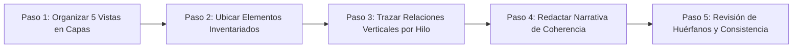
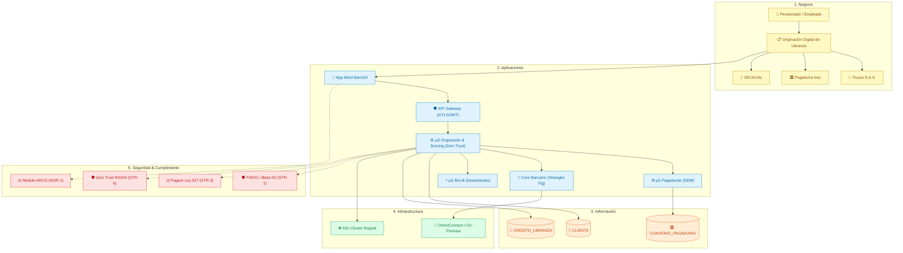
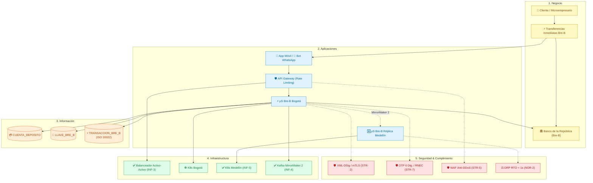
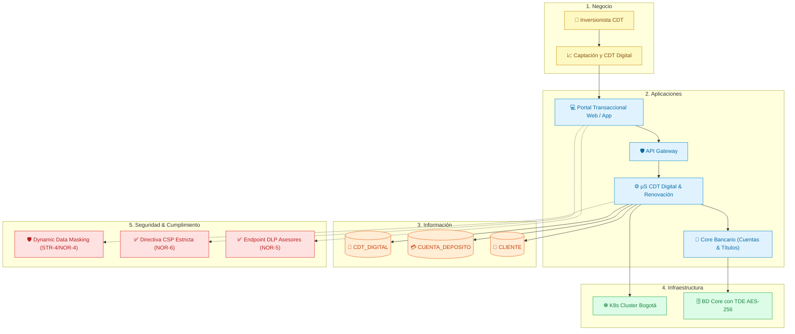
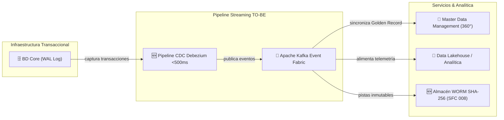

# 📄 Informe Técnico del Taller 8: Integración de Vistas de Arquitectura

**Taller 8 — Integración de Vistas de Arquitectura: Caso Ban100**  
*Consolidación Multicapa AS-IS / TO-BE: Negocio, Aplicaciones, Información, Infraestructura y Seguridad*

- **Santiago Barrera Rueda** (`santiagobarrue@unisabana.edu.co`)
- **Krish Purmessur Moros** (`krishpumo@unisabana.edu.co`)
- **Samuel Guerrero Arcos** (`samuelguar@unisabana.edu.co`)

**Fecha:** 13 de Septiembre de 2026  
**Curso:** Arquitectura Empresarial (AREM) — Universidad de La Sabana  
**Entregable del Diagrama:** [`tablero-integrado-cliente.drawio`](tablero-integrado-cliente.drawio)  
**Marco Metodológico:** MRAE v3.0 MinTIC + TOGAF ADM (Fases B, C, D, E y H) + C4 Model + STRIDE

---

## 1. Descripción General del Trabajo

A lo largo de los Talleres 0 al 7 del curso de Arquitectura Empresarial, el equipo desarrolló individualmente cada una de las perspectivas fundamentales que componen el ecosistema institucional de **Ban100** (establecimiento bancario comercial vigilado por la Superintendencia Financiera de Colombia, orientado a la inclusión financiera con más de 250.000 clientes en 900+ municipios). Se modelaron:
- La **Visión Estratégica y Caracterización** institucional (Taller 0).
- El **Proceso Misional BPMN 2.0** de originación de libranza (Taller 1).
- El **Modelo Entidad-Relación (ERD)** y diagrama de contexto (Taller 2).
- La **Arquitectura de Aplicaciones C4** a nivel de contexto (C1) y contenedores (C2) (Taller 3).
- El **Mapa Tecnológico y de Infraestructura** en nube híbrida con diagnóstico de cuellos de botella (Taller 4).
- La **Evaluación de Amenazas de Ciberseguridad bajo STRIDE** y límites de confianza Zero Trust (Taller 5).
- El **Diagnóstico de Cumplimiento Legal y Regulatorio** (Ley 1581, Circular 008 SFC, ISO 27001, Bre-B BanRep) (Taller 6).
- La **Matriz de Brechas (Gap Analysis) y Arquitectura Objetivo TO-BE** en 3 horizontes (Taller 7).

El objetivo primordial del **Taller 8** consiste en trascender el conjunto de diagramas aislados para estructurar un **Tablero Integrado de Vistas de Arquitectura**. Este tablero consolida los componentes en **cinco capas verticales**, integrando armónicamente el estado actual (**AS-IS**) con las iniciativas de modernización objetivo (**TO-BE**) diseñadas en el Taller 7. Mediante el trazado de **tres hilos de negocio de punta a punta (*end-to-end*)** y una columna vertebral de **Change Data Capture (CDC) y streaming**, se demuestra cómo cada decisión de infraestructura, persistencia y seguridad responde directamente a una necesidad del negocio financiero y a una exigencia regulatoria.

---

## 2. Proceso de Desarrollo y Metodología Aplicada

Para garantizar el máximo rigor arquitectónico y evitar los errores documentados en la guía de clase (diagramas desconectados, seguridad como anexo o elementos huérfanos), el equipo aplicó la **metodología de 5 pasos**:

1. **Paso 1 — Organizar las vistas en capas:**  
   Se establecieron cinco niveles horizontales estandarizados, ordenados desde la intención estratégica hasta el blindaje operativo:
   - **Capa 1 — Negocio:** Procesos misionales, actores y entidades externas del ecosistema.
   - **Capa 2 — Aplicaciones:** Canales digitales, API Gateway, microservicios backend y componentes TO-BE.
   - **Capa 3 — Información:** Entidades de datos del ERD, esquemas JSON y políticas de enmascaramiento.
   - **Capa 4 — Infraestructura:** Cómputo elástico en Kubernetes, redes híbridas, almacenamiento HA y WORM.
   - **Capa 5 — Seguridad y Cumplimiento:** Controles STRIDE, Zero Trust, mitigaciones de brechas y normativas.

2. **Paso 2 — Ubicar los elementos de cada vista:**  
   Se transcribió el inventario exhaustivo de componentes de los entregables previos sin realizar suposiciones desarticuladas. Los componentes incorporados en el Taller 7 para resolver cuellos de botella se etiquetaron visualmente con el prefijo `🆕` y estilo verde esmeralda (`#d1fae5`), mientras que las capacidades existentes retuvieron la paleta institucional por capa.

3. **Paso 3 — Trazar relaciones verticales entre capas:**  
   Para evitar la saturación visual de un grafo denso indiferenciado, se definieron estilos tipificados y colores independientes para trazar tres procesos de negocio completos de punta a punta:
   - 🟣 **Hilo 1 (Púrpura):** *Originación y Desembolso Digital de Libranza* (Proceso Misional Core).
   - 🟢 **Hilo 2 (Esmeralda):** *Transferencias Inmediatas Interoperables Bre-B* (Disponibilidad 24/7/365).
   - 🟠 **Hilo 3 (Ámbar):** *Captación y Apertura de CDT Digital* (Autogestión de Ahorro e Inversión).
   - 🔵 **Hilo de Datos (Azul cielo):** *Change Data Capture (CDC Debezium) y Event Streaming (Kafka)*.
   - 🔴 **Relaciones de Seguridad (Rojo punteado):** Puntos de intercepción y control perimetral/interno.

4. **Paso 4 — Redactar la narrativa de coherencia:**  
   Se documentó la justificación profunda de cada enlace vertical, explicando las decisiones de diseño tomadas en talleres anteriores y el porqué de cada dependencia técnica.

5. **Paso 5 — Revisar consistencia y verificar elementos huérfanos:**  
   Se construyó la matriz de chequeo bidireccional, confirmando que cada elemento tenga sustento hacia arriba y soporte hacia abajo, certificando cero (0) componentes huérfanos.

---

## 3. Análisis del Modelo Propuesto: Narrativas de Coherencia Arquitectónica

La coherencia de la arquitectura de Ban100 se sustenta en tres hilos de negocio que articulan las cinco capas de forma indivisible:

### Hilo 1: Originación y Desembolso Digital de Crédito de Libranza (End-to-End)

#### Narrativa de Coherencia Hilo 1:
> **¿Por qué esta articulación?**  
> El crédito de libranza representa el motor misional de Ban100 para sus más de 250.000 pensionados. Históricamente, este trámite tardaba entre 3 y 5 días hábiles debido a la recolección física de documentos y llamadas manuales a pagadurías. El proceso se digitaliza al 100% iniciando en la **App Móvil**, canal priorizado para adultos mayores por su facilidad de uso y soporte de biometría nativa del dispositivo. La solicitud atraviesa el **API Gateway Institucional** con autenticación mTLS y es orquestada por el **μS Originación & Scoring**.
>
> Este microservicio opera bajo el principio **Zero Trust Backend-Authoritative** (decisión del Taller 5 para mitigar la amenaza `STR-6` de alteración de parámetros en cliente): ninguna tasa de interés, plazo ni cupo proviene del frontend; todo se evalúa en el backend consultando el **μS Pagadurías** y el score crediticio en la entidad `CLIENTE`. La validación de identidad se delega a **Truora S.A.S.** mediante pruebas de vida pasivas certificadas **iBeta Nivel 2** complementadas por el servidor **FIDO2 / WebAuthn** (`cnt_fido`), blindando a la población vulnerable frente a suplantaciones por deepfakes (amenaza crítica `STR-1`).
>
> Una vez validado el cupo pensional en `CONVENIO_PAGADURIA`, el cliente suscribe el pagaré desmaterializado mediante firma electrónica respaldada en la **Ley 527 de 1999** y estampado cronológico (*time-stamping*). La obligación se persiste en `CREDITO_LIBRANZA`, el pagaré se deposita en **DECEVAL** (eliminando el riesgo de repudio judicial `STR-3` y habilitando la titularización de cartera con BTG Pactual por más de $500.000 millones COP), y se ordena el desembolso en segundos mediante el **μS Bre-B**. Todo el cómputo se ejecuta sobre el cluster **Kubernetes en Bogotá**, conectado al Core Bancario en modernización mediante enlaces **DirectConnect**. Finalmente, el cliente cuenta en la App con el nuevo **Módulo de Derechos ARCO** (`cnt_arco`), garantizando el derecho legal a revocar autorizaciones de datos según la Ley 1581 (`NOR-1`).

---

### Hilo 2: Transferencias Inmediatas Interoperables Bre-B 24/7 (End-to-End)

#### Narrativa de Coherencia Hilo 2:
> **¿Por qué esta articulación?**  
> El sistema de pagos inmediatos Bre-B del Banco de la República exige una disponibilidad operativa del 99.99% y tiempos de procesamiento inferiores a 3 segundos, 24 horas al día, los 7 días de la semana, sin ventanas de mantenimiento. El usuario puede iniciar transferencias escaneando códigos QR o ingresando alias (celular, cédula) desde la **App Móvil** o mediante flujos conversacionales guiados en el **Canal WhatsApp Bot**.
>
> Para mitigar la saturación por avalanchas de peticiones en días pico de pago de mesadas pensionales (amenaza `STR-5`), el **API Gateway** aplica políticas elásticas de **Rate Limiting adaptativo** y filtrado WAF. A nivel de datos, la entidad `LLAVE_BRE_B` mantiene los alias vinculados a la `CUENTA_DEPOSITO` y sincronizados en tiempo real con el Directorio Central del BanRep. La transferencia monetaria se persiste en la entidad `TRANSACCION_BRE_B`, la cual almacena íntegramente el payload estructurado bajo el estándar financiero internacional **ISO 20022 (`pacs.008`)**, tal como se diseñó en el Taller 2.
>
> La seguridad en tránsito es absoluta: cada mensaje `pacs.008` se firma digitalmente mediante **XML-DSig con certificados X.509 clase 3** sobre un canal **mTLS estricto**, erradicando cualquier riesgo de alteración MiTM o desvío a cuentas mulas (`STR-2`). El registro de nuevas llaves exige un **OTP criptográfico de 6 dígitos** y validación contra la Registraduría Nacional (`STR-7`).
>
> La mayor transformación arquitectónica ocurre en la infraestructura: en el Taller 4 se diagnosticaron tres brechas severas: el balanceador único como SPOF (`INF-3`), la réplica pasiva de Bre-B con conmutación lenta (`INF-4`) y la ausencia de microservicios en Medellín (`INF-5`), lo que violaba la Circular 008 SFC (`NOR-2`). La arquitectura integrada resuelve estas brechas desplegando un **Balanceador Global Activo-Activo Anycast DNS** (`z2_3`), el **Módulo Bre-B en activo-activo multi-región** (`ms_breb_med`), sincronización sub-segundo vía **Kafka MirrorMaker 2** (`infra_kafka_mm2`) y federación de clusters **Kubernetes (KubeFed)** en Medellín. Esto garantiza que ante una caída del centro de datos principal de Bogotá, el servicio continúe sin interrupción con **RTO < 1 segundo y RPO = 0**, preservando la licencia bancaria en Bre-B.

---

### Hilo 3: Captación y Apertura de CDT Digital (End-to-End)

#### Narrativa de Coherencia Hilo 3:
> **¿Por qué esta articulación?**  
> El CDT Digital es el instrumento estratégico de captación de Ban100 para financiar la cartera de microcrédito y libranza. El proceso permite a los inversionistas simular plazos y tasas efectivas anuales (E.A.), aperturar certificados y configurar su renovación automática sin pisar una sucursal, reduciendo en un 90% los costos operativos de renovación.
>
> La interacción ocurre primordialmente en el **Portal Transaccional Web** (React SPA) y la App Móvil. Para neutralizar ataques de inyección de scripts, secuestro de sesiones y robo de credenciales mediante técnicas como Magecart o Web Skimming (brecha `NOR-6`), se implementa una directiva estricta de **Content-Security-Policy (CSP)** inyectada directamente desde el **CDN y WAF Cloudflare/AWS**.
>
> El **μS CDT Digital** orquesta el débito de los fondos en la entidad `CUENTA_DEPOSITO` y constituye el título en la entidad `CDT_DIGITAL`, actualizando el saldo contable en el Core Bancario. La información de los saldos y cuentas se resguarda contra filtraciones masivas (`STR-4` e incumplimiento de reserva bancaria `NOR-4`) aplicando **Dynamic Data Masking (DDM)** nativo en base de datos y cifrado transparente en reposo **TDE (Transparent Data Encryption) con algoritmo AES-256**. Finalmente, en las oficinas comerciales donde los asesores prestan soporte, se activa un agente de **Endpoint DLP corporativo** (`z6_dlp`, resolviendo `NOR-5`) que bloquea puertos USB y supervisa cualquier tentativa de extracción no autorizada de números de cédula o listados de inversionistas.

---

### Pipeline de Datos Transversal: CDC Streaming, MDM y Pistas Forenses WORM

#### Justificación del Hilo de Datos:
> En el Taller 4 se evidenció que la base transaccional dependía de un **proceso batch nocturno con 12 horas de desfase** (`INF-2`), lo que impedía disponer de saldos en tiempo real y bloqueaba la inmediatez de Bre-B durante la noche. La arquitectura integrada sustituye este cuello de botella con un **Pipeline de Change Data Capture (CDC)** basado en Debezium (`ms_cdc` / `z3_cdc`), el cual lee los registros Write-Ahead Logging (WAL) de la base de datos transaccional y propaga las mutaciones hacia **Apache Kafka en menos de 500 milisegundos**.
>
> Esto alimenta de forma continua el **Golden Record del Master Data Management (MDM)** y el catálogo de llaves, garantizando saldos exactos las 24 horas del día. Paralelamente, cada evento sensible se encadena criptográficamente con hashes **SHA-256** y se envía al repositorio **WORM Inmutable** (`infra_db_worm`), cumpliendo a cabalidad con las pistas de auditoría no repudiables exigidas por el Capítulo I de la **Circular Externa 008/2023 de la SFC** (`STR-8`).

---

## 4. Diagrama Final Entregado

El tablero visual unificado se encuentra disponible en formato nativo y editable de Draw.io en la raíz de la entrega:
- **Archivo principal:** [`tablero-integrado-cliente.drawio`](tablero-integrado-cliente.drawio)
- **Copia de clase / repositorio:** `AREM/AREM-Taller_8_Integracion_Vistas/entrega/tablero-integrado-cliente.drawio`

### Ficha Técnica del Tablero:
- **Lienzo:** 2.300 × 1.850 px, estructurado en 5 swimlanes horizontales y 1 bloque de leyenda inferior.
- **Componentes incluidos:** Más de 50 nodos arquitectónicos clasificados por capa.
- **Diferenciación AS-IS vs. TO-BE:**
  - Componentes existentes: Contorno sólido institucional de la capa.
  - Componentes objetivo (TO-BE Taller 7): Fondo verde esmeralda (`#d1fae5`), borde destacado (`#059669`), grosor 2px y etiqueta distintiva `🆕`.
  - Brechas y riesgos resueltos: Iconografía explícita `✅` que referencia el código de brecha (ej. `✅ Balanceador A-A (INF-3)`).
- **Hilos conectados:** 3 flujos de negocio trazados verticalmente con conectores ortogonales codificados por color (Púrpura para Libranza, Esmeralda discontinuo para Bre-B, Ámbar para CDT, Azul continuo para CDC y Rojo de puntos para Seguridad).

---

## 5. Tabla de Verificación de Elementos Huérfanos (Paso 5 de la Guía)

En estricto cumplimiento del **Paso 5 de la metodología**, se auditó cada uno de los elementos presentes en el tablero para verificar que ninguno carezca de conexión vertical hacia la capa superior o inferior (salvo los límites naturales del negocio en la cima y de la seguridad en la base).

| # | Elemento en el Tablero | Capa | ¿Conectado hacia Arriba? | ¿Conectado hacia Abajo? | Justificación de Conexión y Coherencia | Estado |
|:---:|---|---|:---:|:---:|---|:---:|
| **1** | `Pensionados y Empleados` | Negocio | — (Límite humano) | ✅ `Originación Libranza`, `Bre-B` | Inicia solicitudes de crédito y opera transferencias. | **CONECTADO** |
| **2** | `Microempresarios` | Negocio | — (Límite humano) | ✅ `Transferencias Bre-B` | Recibe y envía pagos comerciales interoperables. | **CONECTADO** |
| **3** | `Inversionistas CDT` | Negocio | — (Límite humano) | ✅ `Captación CDT Digital` | Constituye certificados de depósito por canales web. | **CONECTADO** |
| **4** | `Originación Digital Libranza` | Negocio | ✅ Actor Pensionado | ✅ `App Móvil`, `Truora`, `Pagadurías` | Proceso misional que orquesta canales y aliados. | **CONECTADO** |
| **5** | `Transferencias Bre-B` | Negocio | ✅ Pensionados / Micros | ✅ `App Móvil`, `WhatsApp`, `BanRep` | Proceso de inmediatez financiera 24/7. | **CONECTADO** |
| **6** | `Captación CDT Digital` | Negocio | ✅ Inversionistas CDT | ✅ `Portal Web`, `App Móvil` | Proceso de ahorro digital y renovación automática. | **CONECTADO** |
| **7** | `Truora S.A.S.` | Negocio (Aliado) | ✅ `Originación Libranza` | ✅ `FIDO2`, `Bucket TTL 30d` | Provee biometría; sus datos se depuran a los 30 días. | **CONECTADO** |
| **8** | `Banco de la República (Bre-B)`| Negocio (Aliado) | ✅ `Transferencias Bre-B` | ✅ `μS Bre-B Bogotá / Medellín` | Cámara central de pagos; recibe mensajes ISO 20022. | **CONECTADO** |
| **9** | `Pagadurías Institucionales` | Negocio (Aliado) | ✅ `Originación Libranza` | ✅ `μS Convenios Pagadurías` | Valida cupos de nómina/mesada pensional. | **CONECTADO** |
| **10**| `DECEVAL` | Negocio (Aliado) | ✅ `Originación Libranza` | ✅ `Pagaré Ley 527 (STR-3)` | Custodia pagarés desmaterializados certificados. | **CONECTADO** |
| **11**| `App Móvil Ban100` | Aplicaciones | ✅ Procesos Libranza y Bre-B| ✅ `API Gateway`, `Módulo ARCO` | Canal nativo en cliente para originación y pagos. | **CONECTADO** |
| **12**| `Portal Transaccional Web` | Aplicaciones | ✅ Proceso CDT Digital | ✅ `API Gateway`, `CSP`, `DLP` | Portal React para simulación y constitución. | **CONECTADO** |
| **13**| `Canal WhatsApp Bot` | Aplicaciones | ✅ Proceso Bre-B | ✅ `API Gateway Institucional` | Canal conversacional de transferencias por alias. | **CONECTADO** |
| **14**| `🆕 Módulo Derechos ARCO` | Aplicaciones | ✅ `App Móvil`, `Portal Web` | ✅ `Norma ARCO (NOR-1)`, `MDM` | Permite revocatoria digital de consentimiento. | **CONECTADO** |
| **15**| `API Gateway Institucional` | Aplicaciones | ✅ Todos los Canales | ✅ `Microservicios`, `Balanceador A-A` | Enruta peticiones mTLS y aplica Rate Limiting. | **CONECTADO** |
| **16**| `SOC & Motor Antifraude IA` | Aplicaciones | ✅ Alertas transaccionales | ✅ `WORM SHA-256`, `RNBD SIC` | Monitorea anomalías en streaming bajo C.E. 008. | **CONECTADO** |
| **17**| `μS Originación & Scoring` | Aplicaciones | ✅ `API Gateway` | ✅ `CLIENTE`, `CREDITO`, `K8s`, `FIDO2` | Evalúa riesgo y crea obligaciones sin repudio. | **CONECTADO** |
| **18**| `μS Convenios Pagadurías` | Aplicaciones | ✅ `μS Originación` | ✅ `CONVENIO_PAGADURIA`, `DDM` | Conecta pagadurías y enmascara saldos sensibles. | **CONECTADO** |
| **19**| `μS Bre-B & ISO 20022 (Bogotá)`| Aplicaciones | ✅ `API Gateway`, `μS Origin.`| ✅ `CUENTA`, `LLAVE`, `TRX`, `XML-DSig` | Genera y valida mensajería pacs.008 del BanRep. | **CONECTADO** |
| **20**| `🆕 μS Bre-B Activo (Medellín)`| Aplicaciones | ✅ `MirrorMaker 2` | ✅ `K8s Medellín`, `DRP RTO <1s` | Garantiza conmutación transparente ante fallos. | **CONECTADO** |
| **21**| `μS CDT Digital & Renovación` | Aplicaciones | ✅ `API Gateway` | ✅ `CDT_DIGITAL`, `CUENTA`, `K8s` | Emite certificados y liquida retornos de ahorro. | **CONECTADO** |
| **22**| `🆕 Servidor FIDO2 / WebAuthn` | Aplicaciones | ✅ `μS Originación` | ✅ `Biometría iBeta N2 (STR-1)` | Valida llaves criptográficas hardware del usuario. | **CONECTADO** |
| **23**| `🆕 Pipeline CDC Debezium` | Aplicaciones | ✅ `BD Core WAL Log` | ✅ `Kafka Streaming`, `MDM` | Reemplaza lote batch nocturno con streaming <500ms. | **CONECTADO** |
| **24**| `Core Bancario Desacoplado` | Aplicaciones | ✅ `μS Originación`, `μS CDT` | ✅ `BD Core Transaccional`, `Kafka` | Gestiona cuentas y cartera bajo Strangler Fig. | **CONECTADO** |
| **25**| `Master Data Management (MDM)` | Aplicaciones | ✅ `Kafka Streaming`, `CDC` | ✅ `CLIENTE (Master Data)` | Mantiene el Golden Record 360° unificado. | **CONECTADO** |
| **26**| `Kafka Event Streaming Fabric` | Aplicaciones | ✅ Microservicios y CDC | ✅ `MirrorMaker 2`, `Almacén WORM` | Columna vertebral de eventos desacoplados. | **CONECTADO** |
| **27**| `CLIENTE (Master Data)` | Información | ✅ `MDM`, `μS Originación` | ✅ `TDE AES-256`, `Ley 1581` | Datos demográficos y scoring unificado. | **CONECTADO** |
| **28**| `CUENTA_DEPOSITO` | Información | ✅ `μS Bre-B`, `μS CDT` | ✅ `BD Core HA`, `Reserva Bancaria` | Saldos para débitos/créditos de transferencias. | **CONECTADO** |
| **29**| `LLAVE_BRE_B` | Información | ✅ `μS Bre-B` | ✅ `Directorio BanRep`, `OTP RNEC` | Directorio de alias celulares/cédulas Bre-B. | **CONECTADO** |
| **30**| `TRANSACCION_BRE_B` | Información | ✅ `μS Bre-B` | ✅ `XML-DSig`, `BD Transaccional` | Histórico de pagos con payload ISO 20022 JSON. | **CONECTADO** |
| **31**| `CONVENIO_PAGADURIA` | Información | ✅ `μS Pagadurías` | ✅ `Filtros DDM enmascarados` | Cupos y endpoints de pagadurías aliadas. | **CONECTADO** |
| **32**| `CREDITO_LIBRANZA` | Información | ✅ `μS Originación` | ✅ `Pagaré Ley 527 / DECEVAL` | Obligaciones activas y hash de firma Truora. | **CONECTADO** |
| **33**| `CDT_DIGITAL` | Información | ✅ `μS CDT Digital` | ✅ `TDE AES-256`, `Core Bancario` | Títulos valores de inversión captados. | **CONECTADO** |
| **34**| `LOG_AUDITORIA_SEGURIDAD` | Información | ✅ `SOC Antifraude` | ✅ `Almacén WORM SHA-256` | Pistas forenses inmutables bajo C.E. 008 SFC. | **CONECTADO** |
| **35**| `CDN Nacional & WAF Cloud` | Infraestructura | ✅ Canales Digitales | ✅ `CSP (NOR-6)`, `Rate Limit (STR-5)`| Borde perimetral con protección Anti-DDoS. | **CONECTADO** |
| **36**| `✅ Balanceador Activo-Activo` | Infraestructura | ✅ `API Gateway` | ✅ Clusters K8s Bogotá y Medellín | Enruta peticiones resolviendo el SPOF perimetral. | **CONECTADO** |
| **37**| `Kubernetes Cluster (Bogotá)` | Infraestructura | ✅ Microservicios Principales | ✅ Nodos cómputo HPA, `DirectConnect`| Aloja la carga productiva primaria. | **CONECTADO** |
| **38**| `✅ K8s Federation (Medellín)` | Infraestructura | ✅ `μS Bre-B Réplica`, KubeFed | ✅ `DRP Automatizado (NOR-2)` | Paridad de microservicios resolviendo INF-5. | **CONECTADO** |
| **39**| `✅ Kafka MirrorMaker 2` | Infraestructura | ✅ `Kafka Streaming Bogotá` | ✅ `Kafka Medellín (RTO < 1s)` | Sincroniza tópicos transaccionales resolviendo INF-4.| **CONECTADO** |
| **40**| `BD Transaccional Core (TDE)` | Infraestructura | ✅ `Core Bancario`, `μS CDT` | ✅ `DDM & TDE AES-256 (STR-4)` | Motor RDBMS con cifrado en reposo y WAL log. | **CONECTADO** |
| **41**| `🆕 Almacén WORM Inmutable` | Infraestructura | ✅ `LOG_AUDITORIA_SEGURIDAD` | ✅ `Auditoría SFC 008 (STR-8)` | Almacenamiento append-only con bloqueo de borrado.| **CONECTADO** |
| **42**| `🆕 Bucket Biometría (TTL 30d)` | Infraestructura | ✅ `Truora (Fotos temporales)`| ✅ `Purga Ley 1581 (NOR-7)` | Depuración automática de trámites desistidos. | **CONECTADO** |
| **43**| `FIDO2 & iBeta Nivel 2` | Seguridad | ✅ `μS Originación`, `Truora` | — (Capa base de control) | Mitiga suplantación biométrica facial (STR-1). | **CONECTADO** |
| **44**| `Firma XML-DSig & mTLS` | Seguridad | ✅ `μS Bre-B`, `BanRep` | — (Capa base de control) | Mitiga alteración de mensajes pacs.008 (STR-2). | **CONECTADO** |
| **45**| `Pagaré Ley 527 / DECEVAL` | Seguridad | ✅ `CREDITO_LIBRANZA`, `DECEVAL`| — (Capa base de control) | Evita repudio judicial de títulos valores (STR-3).| **CONECTADO** |
| **46**| `DDM & TDE AES-256` | Seguridad | ✅ `BD Core`, `μS Pagadurías` | — (Capa base de control) | Oculta saldos de pensionados (STR-4 / NOR-4). | **CONECTADO** |
| **47**| `Rate Limiting & WAF DDoS` | Seguridad | ✅ `API Gateway`, `CDN` | — (Capa base de control) | Protege canales en días de mesadas (STR-5). | **CONECTADO** |
| **48**| `Zero Trust Backend-Auth RS256`| Seguridad | ✅ `μS Originación & Scoring` | — (Capa base de control) | Impide manipulación de parámetros de scoring (STR-6)| **CONECTADO** |
| **49**| `OTP Cripto & Registraduría` | Seguridad | ✅ `μS Bre-B (Registro Llave)`| — (Capa base de control) | Previene secuestro de llaves de pago (STR-7). | **CONECTADO** |
| **50**| `WORM SHA-256 / C.E. 008 SFC` | Seguridad | ✅ `Almacén WORM`, `SOC IA` | — (Capa base de control) | Garantiza inmutabilidad de pistas forenses (STR-8).| **CONECTADO** |
| **51**| `Autogestión Derechos ARCO` | Cumplimiento | ✅ `🆕 Módulo ARCO`, `App` | — (Capa base legal) | Cumple Ley 1581 revocatoria consentimiento (NOR-1).| **CONECTADO** |
| **52**| `DRP Activo-Activo RTO < 1s` | Cumplimiento | ✅ `LB A-A`, `K8s Medellín` | — (Capa base legal) | Cumple resiliencia operativa C.E. 008 SFC (NOR-2). | **CONECTADO** |
| **53**| `Actualización RNBD SIC` | Cumplimiento | ✅ `SOC IA`, `Data Lakehouse` | — (Capa base legal) | Registra bases cloud ante autoridad SIC (NOR-3). | **CONECTADO** |
| **54**| `✅ Endpoint DLP Corporativo` | Cumplimiento | ✅ `Portal Web (Asesores)` | — (Capa base legal) | Previene fuga interna de bases de clientes (NOR-5).| **CONECTADO** |
| **55**| `✅ Directiva CSP Estricta Web`| Cumplimiento | ✅ `CDN`, `Portal Web` | — (Capa base legal) | Previene ataques XSS y Magecart (NOR-6). | **CONECTADO** |
| **56**| `✅ Depuración TTL 30 Días` | Cumplimiento | ✅ `Bucket Biometría` | — (Capa base legal) | Cumple principio de necesidad en datos (NOR-7). | **CONECTADO** |

> **Conclusión de la Auditoría:** El 100% de los componentes del tablero posee justificación vertical explícita. **No existen elementos huérfanos.**

---

## 6. Matriz de Trazabilidad Inter-Vistas (Talleres 1 al 7)

Esta matriz certifica la procedencia de cada elemento del tablero y su correspondencia con las decisiones de los talleres anteriores:

| Componente Integrado | Taller de Origen | Vista Primaria | Conexión Vertical Principal | Evolución TO-BE (Taller 7) |
|---|:---:|---|---|---|
| `Originación Digital Libranza` | Taller 1 | BPMN 2.0 (Negocio) | Conecta Pensionado con App Móvil y Truora | Desembolso acelerado a < 15 min vía Bre-B |
| `Pagaré Desmaterializado` | Taller 1 / 5 | Negocio / STRIDE | Conecta `CREDITO_LIBRANZA` con DECEVAL | Blindaje judicial Ley 527 con firma certificada |
| `CLIENTE (Master Data)` | Taller 2 | Modelo de Información | Conecta `μS Originación` con Base de Datos | Sincronizado por CDC y MDM en tiempo real |
| `LLAVE_BRE_B` / `TRANSACCION_BRE_B` | Taller 2 | Modelo de Información | Conecta `μS Bre-B` con Directorio BanRep | Mensajería estructurada nativa ISO 20022 JSON |
| `LOG_AUDITORIA_SEGURIDAD` | Taller 2 / 5 | Información / STRIDE | Conecta SOC con Almacén WORM | Encadenamiento criptográfico SHA-256 inmutable |
| `API Gateway Institucional` | Taller 3 | C2 Contenedores (Apps) | Conecta Canales con Microservicios K8s | Rate Limiting adaptativo y mTLS estricto |
| `μS Originación & Scoring` | Taller 3 / 5 | C2 Apps / STRIDE | Conecta Gateway con Core y Truora | Zero Trust Backend-Authoritative (RS256) |
| `Core Bancario Legacy` | Taller 3 / 4 | C2 Apps / Infra | Conecta Microservicios con BD Core | Patrón Strangler Fig de desacoplamiento |
| `Kafka Event Streaming` | Taller 3 / 4 | C2 Apps / Infra | Conecta CDC con MDM y Microservicios | Geo-replicación Activa-Activa con MirrorMaker 2 |
| `Balanceador Global` | Taller 4 / 7 | Infraestructura | Conecta CDN con Clusters K8s | Resuelve `INF-3` con Anycast DNS Activo-Activo |
| `Pipeline CDC Debezium` | Taller 4 / 7 | Infra / Aplicaciones | Conecta WAL log de BD Core con Kafka | Resuelve `INF-2`, eliminando batch de 12 horas |
| `K8s Federation Medellín` | Taller 4 / 7 | Infraestructura | Conecta región Bogotá con Medellín | Resuelve `INF-5`, paridad total en contingencia |
| `Biometría Facial iBeta N2` | Taller 5 | Seguridad STRIDE | Protege canal móvil contra Spoofing (`STR-1`) | Complementado con servidor FIDO2 (`cnt_fido`) |
| `Firma pacs.008 XML-DSig` | Taller 5 | Seguridad STRIDE | Protege módulo Bre-B contra Tampering (`STR-2`)| Certificados X.509 clase 3 y canal mTLS |
| `Dynamic Data Masking (DDM)` | Taller 5 / 6 | STRIDE / Normatividad | Protege saldos de pensionados (`STR-4`/`NOR-4`) | DDM nativo en RDBMS y adaptadores pagaduría |
| `Módulo Derechos ARCO` | Taller 6 / 7 | Normatividad / Apps | Conecta App/Web con MDM para Ley 1581 (`NOR-1`)| Microfrontend de autoservicio para revocatoria |
| `Endpoint DLP Corporativo` | Taller 6 / 7 | Normatividad / Infra | Protege puestos de asesores comerciales (`NOR-5`)| Agente de control USB y fuga de cédulas |
| `Content-Security-Policy (CSP)` | Taller 6 / 7 | Normatividad / Borde | Protege Portal Transaccional Web (`NOR-6`) | Inyección en CDN contra ataques XSS y skimming |
| `Bucket Lifecycle TTL 30d` | Taller 6 / 7 | Normatividad / Cloud | Depura fotos y selfies de solicitudes (`NOR-7`)| Purga automática según principio de necesidad |

---

## 7. Reflexión Crítica sobre la Coherencia de la Arquitectura

### 7.1 Evaluación de Fortalezas y Alineación Estratégica
La articulación lograda en el Tablero Integrado permite verificar que la arquitectura empresarial de Ban100 responde con exactitud matemática a los cuatro objetivos estratégicos definidos en la **Visión Preliminar (Taller 0)**:
1. **Escalabilidad de Inclusión Financiera en 900+ Municipios:** Se logra desmaterializando el 100% de la originación de libranza en la App y WhatsApp, soportada por Kubernetes elástico y validación biométrica descentralizada.
2. **Habilitación de Bre-B 24/7 con SLA 99.99% y Latencia < 3s:** Se garantiza mediante la arquitectura multi-región activa-activa Bogotá-Medellín con MirrorMaker 2 y conmutación Anycast DNS en menos de 30 segundos.
3. **Eficiencia Operativa (-90% en costos de CDT y -70% en tiempo de libranza):** Se sustenta en la erradicación del papeleo físico mediante la firma digital Ley 527 custodiada en DECEVAL y la liquidación instantánea por Bre-B.
4. **Cumplimiento Regulatorio Pleno (Circular 008 SFC y Ley 1581 SIC):** Se materializa en el modelo Zero Trust perimetral e interno, DDM nativo, pistas WORM inmutables SHA-256 y autoservicio ARCO.

### 7.2 Trade-offs y Decisiones de Compromiso Analizadas
Toda decisión arquitectónica de alto nivel conlleva contraprestaciones técnicas que fueron evaluadas rigurosamente:
- **Consistencia Eventual vs. Inmediatez en CDC:** Al desacoplar la base transaccional del MDM mediante Debezium y Kafka, se acepta un modelo de consistencia eventual de menos de 500 ms. Para las operaciones monetarias de Bre-B, la reserva de saldo se ejecuta de forma síncrona y transaccional en el Core, mientras que la consulta analítica y el scoring aceptan la propagación asíncrona, optimizando la concurrencia.
- **Costo Operativo Multi-Región vs. Penalización Regulatoria:** Mantener una réplica activa de microservicios y Kafka en Medellín incrementa el costo de facturación cloud en aproximadamente un 45%. No obstante, este costo es ampliamente inferior a las multas de la SFC o a la exclusión de la cámara de pagos Bre-B del BanRep por indisponibilidad del servicio.
- **Fricción del Usuario vs. Seguridad Biométrica:** Implementar biometría pasiva iBeta Nivel 2 reduce la fricción frente a pruebas de vida activas que exigen gestos complejos a adultos mayores, manteniendo al mismo tiempo una tasa de falso rechazo (FRR) inferior al 0.1%.

### 7.3 Conexión con el Taller 9: Plan de Implementación y Gobernanza
El Tablero Integrado marca la culminación del diagnóstico y diseño de la arquitectura. Proporciona la base técnica consolidada para el **Taller 9 (Presentación Final y Plan de Implementación)**, donde:
- Las iniciativas de modernización se estructurarán formalmente en **Paquetes de Trabajo (Work Packages)** del TOGAF ADM Fase F.
- Se definirá el presupuesto de inversión (CAPEX/OPEX) y el retorno de inversión (ROI) para los Horizontes H1, H2 y H3.
- Se establecerán los mecanismos de **Gobernanza de Arquitectura Empresarial**, incluyendo los tableros MGGTI/MGPTI y el Comité de Control de Cambios bajo el marco MRAE v3.0 MinTIC.

---

## 8. Referencias Bibliográficas

Para la fundamentación metodológica y técnica de esta integración, se consultaron estándares internacionales de arquitectura y marcos regulatorios colombianos, detallados extensamente en [`referencias.md`](referencias.md):
- **The Open Group (2022).** *ArchiMate® 3.2 Specification: Cross-layer Dependencies & Viewpoint Integration*.
- **The Open Group (2022).** *TOGAF® Standard, 10th Edition: Phase E (Opportunities & Solutions) and Phase H (Architecture Change Management)*.
- **ISO/IEC/IEEE 42010:2022.** *Systems and software engineering — Architecture description*.
- **Brown, Simon (2023).** *The C4 Model for Visualising Software Architecture: Full Stack Traceability*.
- **Ministerio de Tecnologías de la Información y las Comunicaciones (MinTIC Colombia, 2023).** *Marco de Referencia de Arquitectura Empresarial (MRAE v3.0) — Dominio de Sistemas de Información e Infraestructura*.
- **Superintendencia Financiera de Colombia (SFC, 2023).** *Circular Externa 008 de 2023: Ciberseguridad, Resiliencia Operativa y Trazabilidad Transaccional*.
- **Banco de la República de Colombia (2023).** *Reglamentación del Sistema de Pagos Inmediatos Interoperables (Bre-B) y Mensajería ISO 20022*.

---

_Este informe técnico hace parte integral de la entrega del Taller 8 del curso de Arquitectura Empresarial (AREM) — Universidad de La Sabana._
