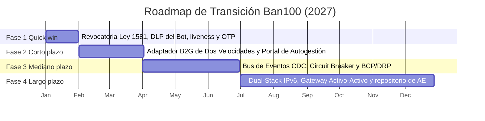

# Plan de Implementación (Roadmap de Transición)

## Cliente

**Ban100 S.A. (Bancien S.A.)** — establecimiento bancario comercial, NIT `900.200.960-9`, Bogotá D.C.

## Integrantes del equipo

- Santiago Barrera Rueda (santiagobarru@unisabana.edu.co)
- Krish Purmessur Moros (krishpumo@unisabana.edu.co)
- Samuel Guerrero Arcos (samuelguar@unisabana.edu.co)

**Equipo:** Ban100 — Grupo de Arquitectura Empresarial

---

## Propósito de este documento

La solución del Taller 7 son tres intervenciones estructurales: el **Adaptador B2G de Dos Velocidades**, el **desacoplamiento asimétrico del Core con Bus CDC** y la **capa agéntica segura con gobierno de datos personales**. Entregar solo ese diseño dejaría a Ban100 con el mismo problema que tiene hoy: sabría a dónde llegar, pero no en qué orden hacerlo sin detener una operación que coloca el 94 % de su cartera por libranza.

El orden importa más de lo habitual en este caso porque el riesgo de mayor nivel (R1, visación limitada por la pagaduría más lenta, Nivel 12) es también el de mayor esfuerzo, y porque dos riesgos regulatorios de bajo esfuerzo (R2 y R3) pueden cerrarse en el primer mes y comprar el tiempo político necesario para abordar el resto.

---

## Fases de implementación

Las cuatro fases corresponden a los Work Packages WP1–WP4 del Taller 7 y a las columnas `Fase del plan que lo mitiga` de [`matriz-riesgos.xlsx`](./matriz-riesgos.xlsx).

| Fase | Qué se implementa | Riesgo / brecha que corrige | Esfuerzo | Duración estimada | Responsable sugerido |
|---|---|---|---|---|---|
| **Quick win** | Módulo de revocatoria y supresión (Ley 1581) con propagación a Cliente 360 y proveedores · política DLP y guardrails del Ban-I Bot · detección de vida certificada y OTP en la validación biométrica | **R2** (Nivel 9, Gobierno TI) · **R3** (Nivel 8, Seguridad) · **R4** (Nivel 8, Seguridad) — brechas G5 y G6 | Bajo–Medio | 0–1 mes | Oficial de Protección de Datos · CISO |
| **Corto plazo** | Adaptador B2G de Dos Velocidades: vía rápida API/X-Road para pagadurías G1–G2 y vía asíncrona RPA/ETL con Portal de Autogestión para G3–G5 · agente con Human-in-the-Loop · firma digital de los archivos de visación · techo de costo por sesión del LLM | **R1** (Nivel 12, Infraestructura) · **R7** (Nivel 6, Datos/Procesos) · **R10** (Nivel 4, Aplicaciones) — brechas G1 y G6 | Alto | 1–3 meses | Líder de Convenios B2G · Arquitecto líder |
| **Mediano plazo** | Bus de Eventos CDC (< 500 ms) con Circuit Breaker hacia el Core · BCP/DRP automatizado · cuentas de servicio de mínimo privilegio y doble autorización de desembolsos | **R5** (Nivel 8, Infraestructura) · **R6** (Nivel 4, Seguridad) — brecha G2 | Alto | 3–6 meses | Líder de Plataforma · Líder del Core Bancario |
| **Largo plazo** | Borde Dual-Stack IPv6/IPv4 en WAF, balanceador y API Gateway · Gateway Activo-Activo · réplica del Cliente 360 (MDM) · repositorio de AE bajo metamodelo MRAE con métricas automatizadas | **R11** (Nivel 2, Infraestructura) · **R9** (Nivel 3, Datos) — brechas G3 y G4 | Medio | 6–12 meses | Líder de Infraestructura · Arquitectura Empresarial |

### Por qué este orden y no el de la columna Prioridad

El riesgo R1 es el de mayor nivel de toda la matriz (Crítico × Alta = 12) y, sin embargo, **no es el quick win**. El Adaptador B2G exige construir dos vías de integración, un motor RPA/ETL y un portal externo: es la pieza de mayor esfuerzo del roadmap. Ponerla primero significaría pasar tres meses sin un solo resultado demostrable ante la Junta.

En su lugar, la Fase 1 cierra R2, R3 y R4, que suman Nivel 25 entre los tres, son de esfuerzo bajo a medio y tienen efecto regulatorio inmediato frente a la SIC y a la Circular Externa 008 de 2023 de la SFC. Es el cruce de prioridad de riesgo con esfuerzo de implementación que pide la guía.

Dos riesgos de la matriz **no generan fase técnica**: R8 (pérdida de un convenio de alto volumen) se gestiona por vía contractual y entra como disparador de cambio en el [procedimiento de actualización](./procedimiento-cambios.md); R12 (desfase por consistencia eventual del bus) se acepta de forma explícita y solo se monitorea.

---

## Línea de tiempo

El arranque se fija en enero de 2027 porque la Fase 1 depende de la aprobación de la visión en el PETI y de la liberación de presupuesto, que es el *call to action* presentado al comité.

---

## Dependencias entre fases

| Dependencia | Explicación |
|---|---|
| **Fase 1 → Fase 2** | El Human-in-the-Loop del agente (Fase 2) exige que la política DLP y los guardrails de la Fase 1 ya estén activos: sin el filtro, escalar una conversación a un analista expone la PII que el filtro debía retener. |
| **Fase 2 → Fase 3** | El Bus CDC desacopla el Core de un originador que, en la Fase 2, ya resuelve la visación por dos vías. Implementar el bus antes obligaría a rehacer sus contratos de eventos cuando llegue el Adaptador. |
| **Fase 3 → Fase 4** | El Gateway Activo-Activo de la Fase 4 solo aporta disponibilidad real si el Core ya está desacoplado: con el enlace síncrono vigente, duplicar el gateway no elimina el punto único de falla, apenas lo desplaza. |
| **Externa (Fase 2)** | La vía rápida del Adaptador depende del ritmo de adopción de cada pagaduría. **No es una dependencia bloqueante**: la vía asíncrona se despliega primero justamente para no quedar sujeta a los plazos MRAE de 40 a 47 meses de los Grupos Territoriales 3 a 5. |
| **Externa (Fase 1)** | La detección de vida certificada depende de la habilitación del módulo correspondiente por parte de Truora, el proveedor de biometría y firma ya contratado. |

---

## Gestión del cambio con las personas

### Grupos afectados

| Grupo | Qué pierde o teme | Resistencia esperada | Poder / interés | Comunicación y capacitación | Cuándo | Responsable |
|---|---|---|---|---|---|---|
| **Analistas de visación B2G** (su tarea actual desaparece) | La validación documental manual de los archivos de pagadurías G3–G5 es hoy su trabajo; temen quedar sin rol cuando el RPA lo absorba | Conservar el control manual «por si el robot falla», duplicando la validación y anulando la ganancia de tiempo | Bajo / Alto | Explicar el rol nuevo: pasan de validar archivos a atender excepciones y acompañar a las pagadurías en el Portal de Autogestión. Capacitación de 4 horas en el tablero de excepciones | Antes del despliegue de la Fase 2 | Líder de Convenios B2G |
| **Pagadurías territoriales G3–G5** (contraparte externa) | Tener que aprender un portal nuevo sin personal ni presupuesto de TI propio | Seguir enviando archivos por el canal anterior e ignorar el portal | Alto / Bajo | Guía de integración de una página y acompañamiento telefónico; el canal anterior se mantiene en paralelo durante los dos primeros meses | Desde el inicio de la Fase 2 | Líder de Convenios B2G |
| **Equipo del Core Bancario (On-Premise)** | Que el Bus CDC vuelva más frágil el soporte de un Core que hoy controlan de punta a punta | Dilatar la Fase 3 con objeciones técnicas y exigir pruebas adicionales | Medio / Alto | Participación directa en la ADR-02 como evaluadores, no como informados; capacitación en el bus de eventos y en el Circuit Breaker | Desde la Fase 1, antes de que la decisión esté cerrada | Arquitecto líder |
| **Oficial de Protección de Datos y Cumplimiento** | Que la automatización de la revocatoria le traslade la responsabilidad de un proceso que no controla técnicamente | Exigir aprobación manual de cada supresión, lo que reintroduce la demora que la Fase 1 elimina | Alto / Alto | Tablero de revocatorias con trazabilidad de cada propagación y reporte mensual verificable ante la SIC | Durante la Fase 1 | CISO |
| **Presidencia Ejecutiva y Junta Directiva** | Invertir durante doce meses sin ver retorno antes del cierre | Aprobar solo las fases con ahorro demostrable y congelar las de infraestructura | Alto / Medio | Un informe de una página al cierre de cada fase con el resultado visible, no con el porcentaje de avance | Al cierre de cada fase | Arquitecto líder |

### Resultado visible por fase

| Fase | Resultado visible | Quién lo comprueba (fuera de TI) |
|---|---|---|
| **Quick win** | Una solicitud de revocatoria presentada por un pensionado queda ejecutada y propagada a Cliente 360 en menos de 24 horas, con constancia descargable | Oficial de Protección de Datos · Defensoría del Consumidor Financiero |
| **Corto plazo** | Una pagaduría del Grupo Territorial 5 completa una visación por el Portal de Autogestión sin que un analista toque el archivo | Líder de Convenios B2G · la propia pagaduría |
| **Mediano plazo** | Durante una ventana de mantenimiento nocturna del Core (30 min), la originación sigue recibiendo y aprobando solicitudes | Operaciones · Revisoría Fiscal (EY Audit S.A.S.) |
| **Largo plazo** | Una entidad pública que ya migró a IPv6 se integra con Ban100 sin requerir traducción de direcciones, y el repositorio de AE publica sus métricas sin intervención manual | Arquitectura Empresarial · auditoría de cumplimiento MRAE |

---

## Referencias

- **TOGAF ADM, Fases E y F** (*Opportunities & Solutions* y *Migration Planning*): secuenciación de Work Packages en Transition Architectures y criterio de agrupar brechas por capacidad antes de ordenar por riesgo.
- **Kotter, J. P. (1996).** *Leading Change*: la urgencia se construye con el primer resultado visible para el negocio, no con el anuncio del proyecto. Sustenta la tabla de resultado visible por fase.
- **MinTIC — MRAE v3.0 (Decreto 767 de 2022):** `MAE.LI.PA.07` (hoja de ruta incorporada al PETI), `MGGTI.LI.ES.02` (PETI a cuatro años con actualización anual) y `MGGTI.LI.ST.14` (adopción de IPv6).
- **Superintendencia Financiera de Colombia — Circular Externa 008 de 2023:** continuidad del negocio y gestión de incidentes, que sustenta la prioridad de la Fase 3.
- Insumos propios del curso: [matriz de brechas del Taller 7](../07-oportunidades-soluciones/matriz-brechas.xlsx) y [mejora de arquitectura](../07-oportunidades-soluciones/mejora-arquitectura.md).

---

_Este documento hace parte de la entrega final del Taller 9 del curso AREM (Arquitectura Empresarial) - Universidad de La Sabana._
