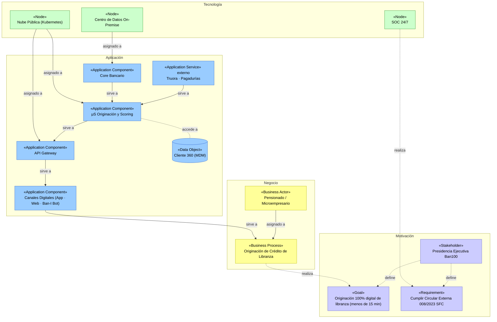
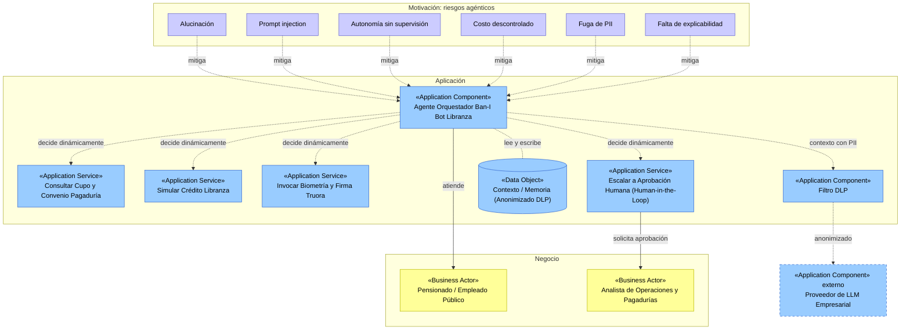

# Archimate — Resumen consolidado (Ban100 S.A.)

Documento único del módulo transversal ArchiMate (informe, vistas y referencias). Los diagramas canónicos siguen siendo los archivos draw.io; los diagramas Mermaid de este documento son una **vista de lectura en GitHub** de los mismos modelos.

| Entregable | Archivo |
|---|---|
| Informe técnico | [Sección 5](#5-informe-técnico) |
| Vista ArchiMate de originación (draw.io) | [`08-integracion-vistas/tablero-integrado-cliente.drawio`](./08-integracion-vistas/tablero-integrado-cliente.drawio) |
| Patrón agéntico Ban-I Bot (draw.io) | [`07-oportunidades-soluciones/to-be-aplicaciones-final.drawio`](./07-oportunidades-soluciones/to-be-aplicaciones-final.drawio) |
| Referencias | [Sección 6](#6-referencias) |

## 1. Viewpoint

> ¿Cómo la infraestructura y las aplicaciones de Ban100 soportan el proceso de originación de crédito de libranza (< 15 min), y cómo ese proceso materializa los objetivos estratégicos y el cumplimiento regulatorio de la entidad?

## 2. Vista ArchiMate de originación de libranza

### Relaciones usadas (ninguna asociación genérica)

| Relación | Uso en la vista |
|---|---|
| Influence | La Presidencia Ejecutiva define el Goal y el Requirement |
| Realization | El proceso realiza el Goal; el SOC realiza el Requirement |
| Assignment | El actor y los nodos se asignan al proceso y a los componentes |
| Serving | Cadena Core / Truora·Pagadurías → μS → API Gateway → Canales → Proceso |
| Access | μS Originación accede a Cliente 360 (MDM) |

## 3. Patrón de sistemas agénticos — Ban-I Bot Libranza (TO-BE)

### Mitigación de los seis riesgos

| Riesgo | Requirement |
|---|---|
| Alucinación | La respuesta se redacta solo a partir de la consulta real a una herramienta |
| Prompt injection | Separar instrucciones del sistema y entrada del usuario; limitar herramientas por contexto |
| Autonomía sin supervisión | Las acciones de alto impacto requieren aprobación humana |
| Costo descontrolado | Límite de iteraciones y presupuesto de llamadas por sesión |
| Fuga de PII | Filtro DLP y anonimización antes del proveedor de LLM |
| Falta de explicabilidad | Registro del razonamiento y de las herramientas invocadas en cada paso |

## 4. Checklist

- [x] Cada elemento está en su capa y color estándar de ArchiMate 3.2.
- [x] Ninguna relación es una asociación genérica.
- [x] Cada elemento conecta con al menos otro elemento; no hay huérfanos.
- [x] Cada herramienta del agente es un Application Service explícito.
- [x] El LLM externo se muestra con borde punteado y detrás de un filtro DLP.

## 5. Informe técnico
### 5.1 Paso 1 — Viewpoint: la pregunta que responde la vista

> **¿Cómo la infraestructura y las aplicaciones de Ban100 soportan el proceso de originación de crédito de libranza (< 15 min), y cómo ese proceso materializa los objetivos estratégicos y el cumplimiento regulatorio de la entidad?**

La vista traza la cadena **motivación → negocio → aplicación → tecnología** para el proceso de mayor impacto (originar libranza en menos de 15 minutos, frente a 3–5 días) y deja fuera, por vivir en su vista especializada: los pasos del proceso (BPMN, Taller 1), los atributos de datos (ERD, Taller 2), los contenedores y protocolos (C4, Taller 3) y la topología y redundancia (Taller 4).

### 5.2 Paso 2 — Elementos identificados por capa

| Capa | Elemento | Tipo | Justificación |
|---|---|---|---|
| Motivación | Presidencia Ejecutiva Ban100 | Stakeholder | Fuente de los objetivos estratégicos de la Ficha |
| Motivación | Originación 100% digital de libranza (< 15 min) | Goal | Objetivos O1 y O3 de la Ficha |
| Motivación | Cumplir Circular Externa 008/2023 SFC | Requirement | Restricción regulatoria del objetivo O4 |
| Negocio | Pensionado / Microempresario | Business Actor | Actores finales del proceso |
| Negocio | Originación de Crédito de Libranza | Business Process | Caja resumen del BPMN del Taller 1 |
| Aplicación | Canales Digitales (App móvil · Web · WhatsApp Bot / Ban-I Bot Libranza) | Application Component | Entrada omnicanal |
| Aplicación | API Gateway | Application Component | Punto único de entrada |
| Aplicación | μS Originación y Scoring | Application Component | Lógica de originación |
| Aplicación | Core Bancario | Application Component | Sistema transaccional On-Premise |
| Aplicación | Truora · Pagadurías | Application Service (externo, punteado) | Biometría/firma y cupos de terceros |
| Aplicación | Cliente 360 (MDM) | Data Object | Dato maestro |
| Tecnología | SOC 24/7 (Monitoreo y Ciberseguridad) | Node | Materializa el requisito regulatorio |
| Tecnología | Nube Pública (Kubernetes) | Node | Aloja μS Originación y API Gateway |
| Tecnología | Centro de Datos On-Premise | Node | Aloja el Core Bancario |

### 5.3 Paso 3 — Relaciones y su justificación semántica

Ninguna relación se modeló como asociación genérica. Los estilos corresponden a la línea base del equipo.

| Origen | Relación (estilo draw.io) | Destino | Por qué esa relación |
|---|---|---|---|
| Presidencia Ejecutiva | **Influence** — `dashed=1;endArrow=open;` | Goal y Requirement | El stakeholder define el objetivo y el requisito; no los ejecuta |
| Originación de Crédito de Libranza | **Realization** — `dashed=1;endArrow=block;endFill=0;` | Goal < 15 min | El proceso concreto materializa el objetivo abstracto |
| Pensionado / Microempresario | **Assignment** — `endArrow=oval;endFill=1;` | Originación de Crédito de Libranza | El actor participa en el proceso |
| Canales Digitales | **Serving** — `endArrow=open;` | Originación de Crédito de Libranza | La aplicación presta servicio al negocio |
| API Gateway | **Serving** | Canales Digitales | El gateway expone servicios a los canales |
| μS Originación y Scoring | **Serving** | API Gateway | El microservicio provee la capacidad que el gateway enruta |
| Truora · Pagadurías | **Serving** | μS Originación y Scoring | Servicios externos consumidos |
| Core Bancario | **Serving** | μS Originación y Scoring | Servicios transaccionales de cartera y desembolso |
| μS Originación y Scoring | **Access** — `dashed=1;endArrow=none;` | Cliente 360 (MDM) | Lee y escribe el dato maestro |
| Nube Pública (Kubernetes) | **Assignment** | μS Originación y API Gateway | El nodo ejecuta y aloja los componentes |
| Centro de Datos On-Premise | **Assignment** | Core Bancario | Esquema híbrido |
| SOC 24/7 | **Realization** | Requirement Circular 008/2023 SFC | La capacidad de monitoreo materializa el requisito |

*Nota de notación:* el estilo de Assignment de la línea base (`endArrow=oval;endFill=1;`) coloca el punto en el extremo de destino; en ArchiMate 3.2 estricto el punto va en el origen y la flecha en el destino. Se mantuvo el estilo del equipo por consistencia con el resto del repositorio; el significado semántico (el origen está asignado al destino) es el mismo.

### 5.4 Paso 4 — Verificación: nada queda suelto

| Capa | Conexión hacia arriba | Conexión hacia abajo |
|---|---|---|
| Motivación | — | Goal recibe Realization del proceso; Requirement recibe Realization del SOC |
| Negocio | Realiza el Goal | Recibe Serving de Canales Digitales |
| Aplicación | Sirve al proceso de negocio | Recibe Assignment de los nodos tecnológicos |
| Tecnología | Assignment a componentes y Realization al Requirement | — |

Los 14 elementos de la vista tienen al menos una relación (13 relaciones en el diagrama).

### 5.5 Diagramas

- [Vista ArchiMate de originación de libranza](./08-integracion-vistas/tablero-integrado-cliente.drawio)
- [Patrón de sistemas agénticos aplicado a Ban-I Bot Libranza](./07-oportunidades-soluciones/to-be-aplicaciones-final.drawio)

Código de colores: lila (Motivación), amarillo (Negocio), azul (Aplicación), verde (Tecnología); servicios externos con borde punteado.

### 5.6 Patrón de sistemas agénticos para Ban-I Bot Libranza (TO-BE)

La versión previa de esta vista no aplicaba el patrón porque el SOC solo usaba analítica de detección. El TO-BE del Taller 7 sí propone un asistente conversacional con un modelo de lenguaje y capacidad de actuar, por lo que corresponde modelarlo con el patrón (orquestador + herramientas + LLM + memoria), sin crear elementos nuevos del metamodelo:

| Elemento | Tipo ArchiMate | Rol |
|---|---|---|
| Pensionado / Empleado Público | Business Actor | Usuario del asistente |
| Agente Orquestador Ban-I Bot Libranza | Application Component | Decide dinámicamente qué herramienta invocar |
| Consultar Cupo y Convenio Pagaduría | Application Service | Herramienta 1 |
| Simular Crédito Libranza | Application Service | Herramienta 2 |
| Invocar Biometría y Firma Truora | Application Service | Herramienta 3 |
| Escalar a Aprobación Humana [Human-in-the-Loop] | Application Service | Herramienta 4; sirve al Analista de Operaciones y Pagadurías |
| Contexto / Memoria de Conversación (Anonimizado DLP) | Data Object | Estado entre pasos |
| Filtro DLP (anonimización de PII) | Application Component | Barrera antes del proveedor externo |
| Proveedor de LLM Empresarial | Application Component (externo, punteado) | Razonamiento |

Los seis riesgos propios de los sistemas agénticos se modelan como *Requirements* de Motivación que *influyen* sobre el orquestador:

| Riesgo | Requirement que lo mitiga |
|---|---|
| Alucinación | La respuesta se redacta solo a partir de la consulta real a una herramienta |
| Prompt injection | Separar instrucciones del sistema y entrada del usuario; limitar herramientas por contexto |
| Autonomía sin supervisión | Acciones de alto impacto requieren aprobación humana |
| Costo descontrolado | Límite de iteraciones y presupuesto de llamadas por sesión |
| Fuga de PII | Filtro DLP y anonimización antes del LLM |
| Falta de explicabilidad | Registrar razonamiento y herramientas invocadas en cada paso |

### 5.7 Trazabilidad con los talleres

| Taller | Aporte | Elemento(s) ArchiMate |
|---|---|---|
| 0 | Objetivos, restricciones, stakeholder | Capa de Motivación |
| 1 | Proceso de originación | Business Process |
| 2 | Dato maestro del cliente | Data Object |
| 3 | Contenedores y externos | Application Components y Service externo |
| 4 | Nodos de despliegue | Capa de Tecnología |
| 5 y 6 | Amenazas y brechas | Requirements y Constraints |
| 7 | Brechas, WP y plateaus | [Vista de Migración](./07-oportunidades-soluciones/vista-archimate-migracion.drawio) |

---

_Este documento hace parte del módulo transversal ArchiMate del curso AREM — Universidad de La Sabana._

## 6. Referencias

1. Ban100 S.A. *Sitio institucional e informe de gestión y sostenibilidad 2024*. https://www.ban100.com.co/. Fecha de consulta: 31/10/2026.
2. Congreso de la República de Colombia. *Ley 527 de 1999 — Comercio electrónico, mensajes de datos y firmas digitales*. Diario Oficial No. 43.673. http://www.secretariasenado.gov.co/senado/basedoc/ley_0527_1999.html. Fecha de consulta: 31/10/2026.
3. Ministerio de Tecnologías de la Información y las Comunicaciones (MinTIC). *Marco de Referencia de Arquitectura Empresarial (MRAE) v3.0*. https://www.mintic.gov.co/arquitecturati/630/w3-channel.html. Fecha de consulta: 31/10/2026.
4. MITRE. *ATLAS — Adversarial Threat Landscape for Artificial-Intelligence Systems*. https://atlas.mitre.org/. Fecha de consulta: 31/10/2026.
5. Superintendencia Financiera de Colombia. *Circular Externa 008 de 2023 — Requerimientos mínimos de seguridad de la información y ciberseguridad*. https://www.superfinanciera.gov.co. Fecha de consulta: 31/10/2026.
6. The Open Group. *ArchiMate® 3.2 Specification*. https://pubs.opengroup.org/architecture/archimate32-doc/. Fecha de consulta: 31/10/2026.
7. The Open Group. *TOGAF® Standard, 10th Edition — Architecture Development Method (ADM)*. https://www.opengroup.org/togaf. Fecha de consulta: 31/10/2026.
8. Truora S.A.S. *Documentación de API — verificación de identidad, biometría y firma electrónica*. https://docs.truora.com/. Fecha de consulta: 31/10/2026.
9. Vega Fernández, C. A. *Guías paso a paso, plantillas y guía de notación ArchiMate del curso Arquitectura Empresarial (AREM)*. Universidad de La Sabana, 2026.
10. Fuente asistida por IA: Claude (Anthropic), octubre 2026 — apoyo en la estructuración, redacción y verificación cruzada de los entregables contra los datos del cliente y las guías del curso.
